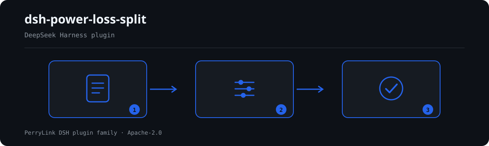

# dsh-power-loss-split — Repartição da energia de perdas de linha e verificação da tabela de avaliação

[English](README.md) · [简体中文](README-zh.md) · [Español](README-es.md) · [Português](README-pt.md) · [हिन्दी](README-hi.md)

[](https://dsh.market/)
[](https://dshfind.com/en/plugins/PerryLink/dsh-power-loss-split?ref=badge)

`dsh-power-loss-split` lê um período de medição de uma linha ou de um posto de transformação — 供电量, 售电量, a 线损电量 e a 线损率 declaradas e, quando o material a traz, a lista de pontos de medição — e faz verificações aritméticas e de intervalo sobre esse material: o balanço de energia, a taxa de perdas, a soma dos pontos de medição, a faixa de taxa de perdas que você configurar e o desequilíbrio entre fases. Cada achado traz os números e a tolerância utilizados, para que a conta possa ser refeita, e toda verificação que não pôde ser executada é listada em `skipped` em vez de passar em silêncio.

## Install

```sh
dsh plugin --profile <name> add dsh-power-loss-split
dsh --profile <name> --dump-config | grep 'dsh-power-loss-split'
```

## Como é a saída



*Visão geral do fluxo: chamada → plugin → resultado. Os exemplos abaixo usam a superfície real de comandos.*


Saída real deste plugin sobre o seu próprio fixture de teste `PL-001` — não é uma simulação. O pacote de regras não inventa citações, por isso cada achado nomeia a cláusula aplicada e avisa que o seu texto não foi obtido.

## O que ele responde

### Exemplos

A tabela abaixo é o conjunto de exemplos: a primeira linha é o caso detalhado e as demais são casos curtos.

#### Saída detalhada

**Ferramenta** `power_loss_split`

**Entrada**

~~~json
{"name":"10kV 某某线","supplied":120000,"sold":114000,"loss":6000,"lossRate":4.2}
~~~
 
**Saída**

~~~json
{
  "id": "dsh-power-loss-split.PL-002.f0566556",
  "ruleId": "PL-002",
  "severity": "warn",
  "locator": {
    "column": "线损率"
  },
  "found": "线损电量 6000 kWh ÷ 供电量 120000 kWh × 100% = 5%，与填报的线损率 4.2% 相差 0.8 个百分点",
  "expected": "线损率应为线损电量与供电量之比，允许偏差 0.01 个百分点",
  "fix": "核对线损率的计算口径（分母是否为供电量、是否含无损电量）；本条只做除法核对"
}
~~~

*Observado em `dsh-power-loss-split/tests/fixtures/PL-002/PL-002-unsafe.json (cases.json expects 1×PL-002); executed parseMaterial+runCheck, checkedAt=2026-10-06T00:00:00.000Z`*

| Você pergunta | O que ele responde |
|---|---|
| A 线损电量 declarada não fecha com 供电量 − 售电量. Qual das três cifras está errada? | `PL-001` não o dirá. Reporta a diferença — `供电量 1000 kWh − 售电量 900 kWh = 100 kWh，与填报的线损电量 50 kWh 相差 50 kWh` — e compara-a com a tolerância `toleranceKwh`, que vem em 0, pelo que as três cifras têm de coincidir exatamente (se reportar em 万 kWh fica uma diferença de arredondamento, e então é preciso configurar uma tolerância diferente de zero). A regra só faz a subtração: não decide qual dos três valores está correto nem verifica se as leituras são do mesmo período (抄表同期性). |
| A 线损率 está preenchida como 5.00%, mas 线损电量 ÷ 供电量 dá 6.25%. O problema está no denominador? | `PL-002` mostra a divisão: calcula 线损电量 ÷ 供电量 × 100 e reporta a diferença em 个百分点 face à taxa declarada, admitindo por omissão `tolerancePoints` 0.01 个百分点 para arredondamento — as regras de arredondamento são citadas à parte, da GB/T 8170-2008, cujo texto literal este pacote também não tem. Não julga se o critério do denominador está correto (口径, por exemplo se a 无损电量 devia ser deduzida): isso tem de ser explicado no material ou configurado por você. |
| A taxa de perdas da minha linha parece-me alta. A ferramenta vai assinalá-la? | Não por si só. `PL-003` compara a 线损率 apenas com a faixa que você configurar (`minRate` / `maxRate`); ambas vêm em 0, ou seja não configuradas, e então a regra é listada em `skipped` com o motivo, em vez de passar em silêncio. Mesmo configurada, está limitada a `info`: um achado significa que a taxa está fora da faixa que você definiu, não que as perdas sejam anómalas. A meta de avaliação é atribuída pela sua instituição por linha e por ano, pelo que nenhum valor é fixado. |
| A lista de pontos de medição soma menos do que a 售电量 declarada. Falta algum ponto de medição? | `PL-004` reporta a diferença e nada mais: soma os pontos de medição que trazem um valor de energia e compara o total com a 售电量 declarada — ou com a 供电量 quando não há 售电量 —, com a tolerância `toleranceKwh` (0 por omissão). Um ponto de medição omitido, um contado duas vezes e leituras não simultâneas (抄表不同期) produzem a mesma diferença, pelo que a causa tem de ser verificada à mão; a regra só faz a adição. |
| A folha só traz valores da fase A e da fase B. O que faz a verificação de desequilíbrio? | `PL-005` é listada em `skipped`: precisa de pontos de medição chamados A, B e C, e com menos de três valores de fase não pode ser executada. Mesmo com os três, o limite `maxUnbalancePercent` vem não configurado (0) e a regra volta a `skipped`. Quando definir um limite, calcula (最大值 − 最小值) ÷ 最大值, imprime essa fórmula junto ao achado e está limitada a `info`: não julga se o desequilíbrio constitui um defeito (是否构成缺陷). |

## Normas que segue

| Documento | Número | Regras que o citam |
|---|---|---|
| 《电力网电能损耗计算导则》 | DL/T 686-2018 | PL-001, PL-002, PL-003, PL-004, PL-005 |
| 《数值修约规则与极限数值的表示和判定》 | GB/T 8170-2008 | PL-002 |

**Boundary:** this plugin does **arithmetic and interval checks** on one metering period's line-loss
figures — the energy balance, the loss rate, the meter-list sum, the phase unbalance — and shows its
working in every finding. It is not a metering or metering-fault tool (there is no probe, no AMI
integration, no hardware model) and it does not decide whether a loss figure is reasonable or whether
tampering occurred. It reads a spreadsheet export and reports which sums do not close.

> ### ⚠️ Read this before trusting a citation in the report
>
> **Every `excerpt` in this plugin's rule pack says, in so many words, that the clause text was not
> obtained.** The two relations the plugin checks — 线损电量 = 供电量 − 售电量 and
> 线损率 = 线损电量 ÷ 供电量 × 100 — are **definitional**, and their normative home is
> **DL/T 686-2018《电力网电能损耗计算导则》**. That standard is **in force**, and its table of
> contents was verified (chapter 3 is 术语和定义, chapter 8 is 电力网电能损耗分析与降损措施效果计算),
> but **its body is not published for free**, so no verbatim clause could be read.
>
> Rather than paraphrase a quotation, this pack states the gap outright in the `excerpt` field and puts
> the honest reasoning in `note`. Everything is therefore capped at `warn` (principle-derived) or `info`
> (locally configured), and a test asserts that no rule claims a quotation it does not have. **When the
> standard text is in hand, two things must be done: replace each `excerpt` with the real clause, and
> raise `kind` to `direct`.** Until then a finding means "these two numbers do not close", not
> "you violated a standard".
>
> **Assessment thresholds are yours, not the standard's.** Line-loss targets are issued per line and per
> year by the enterprise or its superior, so `PL-003`'s band and `PL-005`'s unbalance limit ship
> **empty**, and a rule that cannot run says so in `skipped` rather than passing silently.

## Compatibility

| Superfície | Estado |
|---|---|
| Harness | Faixa de peers `>=0.1.2-rc.1 <0.2.0 \|\| >=0.2.0-0 <0.3.0` — verificada para aceitar tanto `0.2.0-rc.2` quanto `0.2.1-rc.2`. **`engines.dsh` é declarado como `>=0.2.1-0 <0.3.0`** e o host o aplica desde 0.2.1 |
| Node | `^22.19.0 || >=24.0.0` |
| Plataformas | Todas (ESM puro; sem código nativo, sem rede, sem chamada ao modelo) |
| Modo de ferramenta | Funciona em `native` e `ptc`; para um diretório inteiro use `ptc` |

## What it does

A tabela de regras, os campos e o comportamento detalhado estão em [README.md](README.md#what-it-does) (versão principal em inglês). O plugin apenas lista divergências literais frente às cláusulas citadas e indica em `skipped` cada verificação que não pôde ser executada.

## Configuration

Todos os parâmetros ajustáveis ficam no esquema Schemastery de `src/config.ts`, portanto mudam pelo `cordis.yml` sem editar código; os limites por regra ficam no pacote de regras sob `rules/`.

| Chave | Tipo | Padrão | Descrição |
|---|---|---|---|
| `rulesFile` | string | `rules/power-loss-split.yaml` | Caminho do pacote de regras, relativo à raiz do pacote |
| `disabledRules` | string[] | `[]` | Ids de regras a desativar; cada uma aparece em `skipped` |
| `onlyRules` | string[] | `[]` | Executar apenas estas regras; vazio executa todas |
| `skipNotes` | string | `""` | Nota acrescentada a cada motivo de `skipped` |
| `timeoutMs` | number | `120000` | Orçamento de tempo limite cooperativo da ferramenta |

## Material format

Aceita JSON ou YAML. O exemplo completo de campos está em [README.md](README.md#material-format) (versão principal em inglês). Os campos são opcionais na camada de leitura e validados pelo motor, de modo que uma exportação parcial gera achados sobre o que falta em vez de falhar.

## Rule sources

Os dados das regras ficam separados do código: cada regra traz documento, número, cláusula na numeração própria da fonte, trecho literal e URL de origem. O carregador impõe que o trecho seja citação real de pelo menos oito caracteres e que uma verificação baseada apenas em princípio geral (`kind: derived-from-principle`, teto `warn`) ou em política local (`kind: institutional-configuration`, teto `info`) nunca seja declarada `error`.

Os limites verificados e as conclusões deliberadamente **não** afirmadas estão em [README.md](README.md#rule-sources) (versão principal em inglês) e em `rules/evidence/`.

## Troubleshooting

- **O plugin instala mas a ferramenta não aparece**: confirme que `main` resolve para `lib/index.mjs` e que `pnpm run build` o gerou.
- **`dsh plugin add` recusa o pacote**: a faixa de peers cobre `0.1.x` e `0.2.x`; fora dela, conceda isenção explícita com `dsh plugin --profile <name> allow-version <pkg@ver> --dsh-version <runtime> --accept-risk`.
- **Uma regra não executou**: leia o arranjo `skipped`.
- **`check` informa `manifest-peers` como falha**: problema conhecido do `dsh-plugin-dev`; o runtime aplica a compatibilidade na instalação.
- **Os horários parecem deslocados**: toda a aritmética é de hora local sobre as cadeias fornecidas.

## Development

```sh
pnpm install
pnpm run typecheck
pnpm test
pnpm run build
node ../scripts/sync-shared.mjs dsh-power-loss-split
```

O último comando copia o kit compartilhado de `../_shared` para `src/shared/`; execute-o novamente após cada alteração compartilhada.

## PerryLink DSH Plugin Family

Este projeto faz parte da família de plugins do DeepSeek Harness da [PerryLink](https://github.com/PerryLink). O registro fica recolhido abaixo para que cada README mantenha uma primeira tela curta; expanda para ver cada linha e seu status.

<details>
<summary>Expandir todos os plugins</summary>

| Plugin | Status |
|---|---|
| **[dsh-aqua-input-check](https://github.com/PerryLink/dsh-aqua-input-check)** |  |
| **[dsh-archive-check](https://github.com/PerryLink/dsh-archive-check)** |  |
| **[dsh-auto-review](https://github.com/PerryLink/dsh-auto-review)** |  |
| **[dsh-autotier](https://github.com/PerryLink/dsh-autotier)** |  |
| **[dsh-bid-ca-precheck](https://github.com/PerryLink/dsh-bid-ca-precheck)** |  |
| **[dsh-bid-qual-check](https://github.com/PerryLink/dsh-bid-qual-check)** |  |
| **[dsh-cert-mcp](https://github.com/PerryLink/dsh-cert-mcp)** |  |
| **[dsh-checkpoint-rewind](https://github.com/PerryLink/dsh-checkpoint-rewind)** |  |
| **[dsh-click](https://github.com/PerryLink/dsh-click)** |  |
| **[dsh-composer-history](https://github.com/PerryLink/dsh-composer-history)** |  |
| **[dsh-contract-stance](https://github.com/PerryLink/dsh-contract-stance)** |  |
| **[dsh-customs-doc-check](https://github.com/PerryLink/dsh-customs-doc-check)** |  |
| **[dsh-data-quality](https://github.com/PerryLink/dsh-data-quality)** |  |
| **[dsh-demurrage-ledger](https://github.com/PerryLink/dsh-demurrage-ledger)** |  |
| **[dsh-doublecheck](https://github.com/PerryLink/dsh-doublecheck)** |  |
| **[dsh-drill-script-check](https://github.com/PerryLink/dsh-drill-script-check)** |  |
| **[dsh-eia-guide-check](https://github.com/PerryLink/dsh-eia-guide-check)** |  |
| **[dsh-emergency-plan](https://github.com/PerryLink/dsh-emergency-plan)** |  |
| **[dsh-essay-rubric-check](https://github.com/PerryLink/dsh-essay-rubric-check)** |  |
| **[dsh-evidence-check](https://github.com/PerryLink/dsh-evidence-check)** |  |
| **[dsh-export-ctl-check](https://github.com/PerryLink/dsh-export-ctl-check)** |  |
| **[dsh-fast](https://github.com/PerryLink/dsh-fast)** |  |
| **[dsh-fmea-table-check](https://github.com/PerryLink/dsh-fmea-table-check)** |  |
| **[dsh-forecast-penalty](https://github.com/PerryLink/dsh-forecast-penalty)** |  |
| **[dsh-fund-research](https://github.com/PerryLink/dsh-fund-research)** |  |
| **[dsh-github](https://github.com/PerryLink/dsh-github)** |  |
| **[dsh-gongwen-flow-check](https://github.com/PerryLink/dsh-gongwen-flow-check)** |  |
| **[dsh-gongwen-word-check](https://github.com/PerryLink/dsh-gongwen-word-check)** |  |
| **[dsh-guard-plan-qc](https://github.com/PerryLink/dsh-guard-plan-qc)** |  |
| **[dsh-hazchem-check](https://github.com/PerryLink/dsh-hazchem-check)** |  |
| **[dsh-hazplan-check](https://github.com/PerryLink/dsh-hazplan-check)** |  |
| **[dsh-hidden-risk-map](https://github.com/PerryLink/dsh-hidden-risk-map)** |  |
| **[dsh-hs-classify](https://github.com/PerryLink/dsh-hs-classify)** |  |
| **[dsh-icd-rule-check](https://github.com/PerryLink/dsh-icd-rule-check)** |  |
| **[dsh-industry-research](https://github.com/PerryLink/dsh-industry-research)** |  |
| **[dsh-lawcite-adapter](https://github.com/PerryLink/dsh-lawcite-adapter)** |  |
| **[dsh-laya](https://github.com/PerryLink/dsh-laya)** |  |
| **[dsh-lc-doc-check](https://github.com/PerryLink/dsh-lc-doc-check)** |  |
| **[dsh-learning-gap-check](https://github.com/PerryLink/dsh-learning-gap-check)** |  |
| **[dsh-library](https://github.com/PerryLink/dsh-library)** |  |
| **[dsh-local-ai](https://github.com/PerryLink/dsh-local-ai)** |  |
| **[dsh-lsp-actions](https://github.com/PerryLink/dsh-lsp-actions)** |  |
| **[dsh-mask](https://github.com/PerryLink/dsh-mask)** |  |
| **[dsh-mcp-panel](https://github.com/PerryLink/dsh-mcp-panel)** |  |
| **[dsh-medrec-qc](https://github.com/PerryLink/dsh-medrec-qc)** |  |
| **[dsh-memento](https://github.com/PerryLink/dsh-memento)** |  |
| **[dsh-nsfc-form-check](https://github.com/PerryLink/dsh-nsfc-form-check)** |  |
| **[dsh-nurse-record-check](https://github.com/PerryLink/dsh-nurse-record-check)** |  |
| **[dsh-observe](https://github.com/PerryLink/dsh-observe)** |  |
| **[dsh-origin-rvc-check](https://github.com/PerryLink/dsh-origin-rvc-check)** |  |
| **[dsh-ota-review-check](https://github.com/PerryLink/dsh-ota-review-check)** |  |
| **[dsh-output-styles](https://github.com/PerryLink/dsh-output-styles)** |  |
| **[dsh-paper-doc-adapter](https://github.com/PerryLink/dsh-paper-doc-adapter)** |  |
| **[dsh-permission-rules](https://github.com/PerryLink/dsh-permission-rules)** |  |
| **[dsh-permit-report-check](https://github.com/PerryLink/dsh-permit-report-check)** |  |
| **[dsh-pipeline-check](https://github.com/PerryLink/dsh-pipeline-check)** |  |
| **[dsh-pleading-draft](https://github.com/PerryLink/dsh-pleading-draft)** |  |
| **[dsh-plugin-doctor](https://github.com/PerryLink/dsh-plugin-doctor)** |  |
| **[dsh-plugin-guide](https://github.com/PerryLink/dsh-plugin-guide)** |  |
| **[dsh-plugin-kit](https://github.com/PerryLink/dsh-plugin-kit)** |  |
| **[dsh-plugin-upgrade](https://github.com/PerryLink/dsh-plugin-upgrade)** |  |
| **[dsh-policy-brief-draft](https://github.com/PerryLink/dsh-policy-brief-draft)** |  |
| **[dsh-power-loss-split](https://github.com/PerryLink/dsh-power-loss-split)** |  |
| **[dsh-power-ticket-check](https://github.com/PerryLink/dsh-power-ticket-check)** |  |
| **[dsh-ppap-check](https://github.com/PerryLink/dsh-ppap-check)** |  |
| **[dsh-protest-deadline](https://github.com/PerryLink/dsh-protest-deadline)** |  |
| **[dsh-railway-window](https://github.com/PerryLink/dsh-railway-window)** |  |
| **[dsh-repair-order-qc](https://github.com/PerryLink/dsh-repair-order-qc)** |  |
| **[dsh-research-report](https://github.com/PerryLink/dsh-research-report)** |  |
| **[dsh-review-reply-check](https://github.com/PerryLink/dsh-review-reply-check)** |  |
| **[dsh-rulefile-check](https://github.com/PerryLink/dsh-rulefile-check)** |  |
| **[dsh-safety-brief-check](https://github.com/PerryLink/dsh-safety-brief-check)** |  |
| **[dsh-score](https://github.com/PerryLink/dsh-score)** |  |
| **[dsh-session-sync](https://github.com/PerryLink/dsh-session-sync)** |  |
| **[dsh-site-log-check](https://github.com/PerryLink/dsh-site-log-check)** |  |
| **[dsh-skill-pack-security](https://github.com/PerryLink/dsh-skill-pack-security)** |  |
| **[dsh-soe-decision-check](https://github.com/PerryLink/dsh-soe-decision-check)** |  |
| **[dsh-soilwater-check](https://github.com/PerryLink/dsh-soilwater-check)** |  |
| **[dsh-sop-sync-check](https://github.com/PerryLink/dsh-sop-sync-check)** |  |
| **[dsh-spc-gbt-adapter](https://github.com/PerryLink/dsh-spc-gbt-adapter)** |  |
| **[dsh-talk](https://github.com/PerryLink/dsh-talk)** |  |
| **[dsh-tender-extract](https://github.com/PerryLink/dsh-tender-extract)** |  |
| **[dsh-tender-matrix](https://github.com/PerryLink/dsh-tender-matrix)** |  |
| **[dsh-test-drive](https://github.com/PerryLink/dsh-test-drive)** |  |
| **[dsh-ticktick](https://github.com/PerryLink/dsh-ticktick)** |  |
| **[dsh-translate](https://github.com/PerryLink/dsh-translate)** |  |
| **[dsh-warranty-calc](https://github.com/PerryLink/dsh-warranty-calc)** |  |
| **[dsh-budget](https://github.com/PerryLink/dsh-budget)** | 🧊 CONGELADO — ver o README do repositório |
| **[dsh-claude-move](https://github.com/PerryLink/dsh-claude-move)** | 🧊 CONGELADO — ver o README do repositório |
| **[dsh-defend](https://github.com/PerryLink/dsh-defend)** | 🧊 CONGELADO — ver o README do repositório |
| **[dsh-draw](https://github.com/PerryLink/dsh-draw)** | 🧊 CONGELADO — ver o README do repositório |
| **[dsh-reach](https://github.com/PerryLink/dsh-reach)** | 🧊 CONGELADO — ver o README do repositório |
| **[dsh-background-agents](https://github.com/PerryLink/dsh-background-agents)** | 🚫 RETIRADO — ver o README do repositório |
| **[dsh-session-pin](https://github.com/PerryLink/dsh-session-pin)** | 🚫 RETIRADO — ver o README do repositório |
| **[dsh-team-rooms](https://github.com/PerryLink/dsh-team-rooms)** | 🚫 RETIRADO — ver o README do repositório |

</details>

## License

[Apache License 2.0](LICENSE) © 2026 dsh-power-loss-split contributors.
