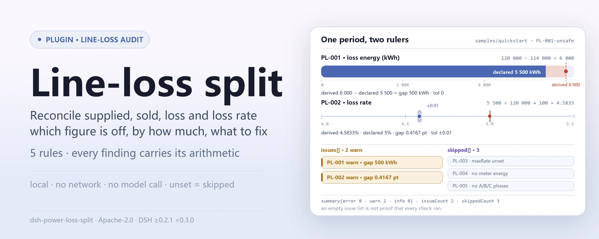

<div align="center">

<picture>
  <source media="(prefers-color-scheme: dark)" srcset="docs/assets/dsh-power-loss-split-hero-en-dark.webp">
  
</picture>

# dsh-power-loss-split

**One metering period of line-loss figures, checked in one pass: which row does not close, by how much, and what to fix.**

A DSH checker for utility line-loss teams: it reads the supplied energy, sold energy, declared line-loss energy and rate, plus the metering-point list when present, then runs arithmetic and interval checks. Every finding carries its numbers and tolerance; every check that cannot run lands in `skipped` with a reason.

[Install](#three-step-setup) · [Configuration](#configuration) · [FAQ](#faq) · [简体中文](README.md) · [English](README.en.md) · [Español](README.es.md) · [Português](README.pt.md) · [हिन्दी](README.hi.md)

[](LICENSE)
[](#compatibility)
[](https://www.npmjs.com/package/dsh-power-loss-split)
[](https://github.com/PerryLink/dsh-power-loss-split/actions/workflows/ci.yml)
[](#compatibility)

[](https://github.com/PerryLink/dsh-power-loss-split/stargazers)
[](https://www.npmjs.com/package/dsh-power-loss-split)
[](https://dshfind.com/plugins/PerryLink/dsh-power-loss-split?ref=badge)
[](https://securityscorecards.dev/viewer/?uri=github.com/PerryLink/dsh-power-loss-split)
[](https://dsh.market/)
[](https://gitee.com/perrylink/dsh-power-loss-split)

```sh
dsh plugin --profile <name> add dsh-power-loss-split
```

</div>

<sub>Community plugin, not affiliated with DeepSeek. Canonical repository: <https://github.com/PerryLink/dsh-power-loss-split> (Gitee is a mirror).</sub>

## What it is

`dsh-power-loss-split` reads one metering period for one line or transformer district — `supplied` (supplied energy), `sold` (sold energy), `loss` (declared line-loss energy), `lossRate` (declared line-loss rate), and the `meters` list when the material carries one — and runs arithmetic and interval checks on those figures: the energy balance, the loss rate, the meter-list sum, the loss-rate band you configure, and the three-phase unbalance. Every finding carries the numbers and the tolerance it used, so a reviewer can redo the sum; every check that could not run is listed in `skipped` instead of passing silently.

```text
material (JSON / YAML)──power_loss_split──▶ rules/power-loss-split.yaml
                                                │ PL-001 … PL-005
                                                ▼
                             report: found · expected · fix
                                     skipped[]: rule id + reason
```

The tool is `power_loss_split`; material comes from a `file` path or inline `material` text. All computation happens host-side — no network, no model call.

<picture>
  <source media="(prefers-color-scheme: dark)" srcset="docs/assets/dsh-power-loss-split-flow-v5-dark.svg">
  
</picture>

## Three-step setup

1. **Install** (pick one channel; npm has `0.2.10`):

   ```sh
   # git channel (latest main)
   dsh plugin --profile web add github:PerryLink/dsh-power-loss-split
   # npm channel (published releases)
   dsh plugin --profile web add dsh-power-loss-split
   # tarball channel: pnpm pack in this repo, then
   dsh plugin --profile web add ./dsh-power-loss-split-<version>.tgz
   ```

   The published package ships `lib/index.mjs`; a source checkout needs `pnpm install && pnpm run build` first.

2. **Minimal config** (defaults are usable; the rule pack ships with the package):

   ```yaml
   - insert:
       - id: dsh-power-loss-split
         name: dsh-power-loss-split
         config:
           timeoutMs: 120000
   ```

3. **Verify it works** (bundled sample, no material of your own needed):

   ```sh
   pnpm install && pnpm run build
   node samples/quickstart/run.mjs
   dsh --profile web --dump-config | grep 'dsh-power-loss-split'
   ```

   Expect `power_loss_split: 2 issue(s) — error 0, warn 2, info 0` and `skipped: 3`, matching `samples/quickstart/expected/result.json`; a screenshot is in `docs/assets/quickstart.png`.

**Uninstall**: `dsh plugin --profile web remove dsh-power-loss-split` (or remove the row from the profile patch).

## Core capabilities

Rule data is separate from code: replacing `rules/power-loss-split.yaml` switches the rule-set version without touching TypeScript.

| Rule | Check | Severity | Basis kind |
|---|---|---|---|
| `PL-001` | supplied − sold = line-loss energy | warn | principle-derived |
| `PL-002` | line-loss energy ÷ supplied × 100 = loss rate | warn | principle-derived |
| `PL-003` | the loss rate sits inside your configured band (off by default) | info | institutional |
| `PL-004` | the meter list sums to the declared sold energy (or supplied) | warn | principle-derived |
| `PL-005` | three-phase unbalance is within your configured limit (off by default) | info | institutional |

- **Every finding shows its arithmetic.** The text spells out `supplied 1000 kWh − sold 900 kWh = 100 kWh` and the declared figure it is compared with; a reviewer who cannot redo the sum cannot judge the finding, so the sum is always there.
- **Not runnable means `skipped`.** An unconfigured threshold, a missing field, or fewer than three phase values puts the rule in `skipped` with its id and reason — an empty issue list can never be read as "nothing is wrong".
- **Citation gaps are stated, not papered over.** The rule pack never invents a quotation: when the verbatim clause could not be obtained, `excerpt` says so and severity is capped at `warn` (principle-derived) or `info` (institutional configuration). A test asserts that no rule claims a quotation it does not have.
- **Lenient number reading.** Thousands separators, unit suffixes, full-width digits, percentages and ten-thousand units all parse; see "Material format" for the token list. A non-numeric cell (`—`, blank) is treated as absent and the affected check reports what it could not do.
- **Pure host.** Pure ESM, no native code, no network request, no model call; tool registration returns a disposer, so unloading removes it.

### Tool parameters

| Argument | Type | Meaning |
|---|---|---|
| `file` | string | Absolute path to the material file (JSON or YAML); mutually exclusive with `material` |
| `material` | string | Inline material text (JSON or YAML); mutually exclusive with `file` |
| `rulesFile` | string | Override the configured rule-pack path (relative to the package or absolute) |
| `only` | string[] | Run only these rule ids; empty runs every rule |

## A real output

The output below comes from an actual run of this plugin against its `PL-002` fixture — not a mock-up. The rule pack does not fabricate citations, so every finding names the clause applied and states that its text was not obtained this time.

**Tool** `power_loss_split`

**Input**

~~~json
{"name":"10kV 某某线","supplied":120000,"sold":114000,"loss":6000,"lossRate":4.2}
~~~

**Output**

~~~json
{
  "id": "dsh-power-loss-split.PL-002.f0566556",
  "ruleId": "PL-002",
  "severity": "warn",
  "locator": {
    "column": "线损率"
  },
  "found": "线损电量 6000 kWh ÷ 供电量 120000 kWh × 100% = 5%，与填报的线损率 4.2% 相差 0.8 个百分点",
  "expected": "线损率应为线损电量与供电量之比，允许偏差 0.01 个百分点",
  "fix": "核对线损率的计算口径（分母是否为供电量、是否含无损电量）；本条只做除法核对"
}
~~~

*Observed from `dsh-power-loss-split/tests/fixtures/PL-002/PL-002-unsafe.json (cases.json expects 1×PL-002); executed parseMaterial+runCheck, checkedAt=2026-10-06T00:00:00.000Z`*

The table below is the example set: the first row is the detailed walkthrough, the remaining rows are short cases.

| You ask | What it answers |
|---|---|
| The declared line-loss energy does not match supplied minus sold. Which of the three figures is wrong? | `PL-001` will not say. It reports the gap — `supplied 1000 kWh − sold 900 kWh = 100 kWh`, a 50 kWh difference from the declared 50 kWh — and compares it with `toleranceKwh`, which ships at 0, so the three figures must agree exactly (reporting in 10k kWh leaves a rounding difference, so configure a non-zero tolerance). The rule only does the subtraction: it does not decide which of the values is correct and does not check whether the readings are from the same period (meter-reading synchronicity). |
| The loss rate is filled in as 5.00%, but line-loss energy ÷ supplied gives 6.25%. Is the denominator the problem? | `PL-002` shows the division: it computes line-loss energy ÷ supplied × 100 and reports the gap in percentage points against the declared rate, allowing `tolerancePoints` 0.01 points by default for rounding — rounding rules are cited separately from GB/T 8170-2008, whose verbatim text this pack also does not have. It does not judge whether the denominator's caliber is right (for example whether loss-free energy should be deducted): that must be stated in the material or configured. |
| Our line's loss rate looks high to me. Will the tool flag it? | Not on its own. `PL-003` compares the loss rate only with the band you configure (`minRate` / `maxRate`); both ship at 0, meaning unconfigured, and then the rule is listed in `skipped` with its reason instead of passing silently. Even configured, it is capped at `info`: a hit means the rate is outside the band you set, not that the loss is abnormal. The assessment target is issued per line and per year by your own institution, so no target value is hard-coded. |
| The metering-point list sums to less than the declared sold energy. Is a metering point missing? | `PL-004` reports the gap and nothing more: it adds the metering points that carry an energy value and compares the total with the declared sold energy — or with supplied energy when no sold figure is given — allowing `toleranceKwh` (0 by default). An omitted metering point, one counted twice, and readings taken at different times all produce the same gap, so the cause must be checked by hand; the rule only does the addition. |
| The sheet carries only A-phase and B-phase values. What does the unbalance check do? | `PL-005` lists itself in `skipped`: it needs metering points named A, B and C, and with fewer than three phase values it cannot run. Even with all three, the limit `maxUnbalancePercent` ships unconfigured (0) and the rule goes to `skipped` again. Once you set a limit it computes (max − min) ÷ max, prints that formula with the finding, and is capped at `info` — it does not judge whether the unbalance constitutes a defect. |

## Rules and basis

| Document | Number | Cited by rules |
|---|---|---|
| Guide for Calculation of Electric Energy Loss in Power Networks | DL/T 686-2018 | PL-001, PL-002, PL-003, PL-004, PL-005 |
| Rules for Rounding off Numerical Values and Judgment of Limiting Values | GB/T 8170-2008 | PL-002 |

**Boundary:** this plugin does **arithmetic and interval checks** on one metering period's line-loss figures — the energy balance, the loss rate, the meter-list sum, the phase unbalance — and shows its working in every finding. It is not a metering or metering-fault tool (there is no probe, no AMI integration, no hardware model) and it does not decide whether a loss figure is reasonable or whether tampering occurred. It reads a spreadsheet export and reports which sums do not close.

> ### ⚠️ Read this before trusting a citation in the report
>
> **Every `excerpt` in this plugin's rule pack says, in so many words, that the clause text was not obtained.** The two relations the plugin checks — line-loss energy = supplied − sold and loss rate = line-loss energy ÷ supplied × 100 — are **definitional**, and their normative home is **DL/T 686-2018 Guide for Calculation of Electric Energy Loss in Power Networks**. That standard is **in force**, and its table of contents was verified (chapter 3 is Terms and Definitions, chapter 8 is Analysis of Electric Energy Loss and Calculation of Loss-Reduction Effects), but **its body is not published for free**, so no verbatim clause could be read.
>
> Rather than paraphrase a quotation, this pack states the gap outright in the `excerpt` field and puts the honest reasoning in `note`. Everything is therefore capped at `warn` (principle-derived) or `info` (locally configured), and a test asserts that no rule claims a quotation it does not have. **When the standard text is in hand, two things must be done: replace each `excerpt` with the real clause, and raise `kind` to `direct`.** Until then a finding means "these two numbers do not close", not "you violated a standard".
>
> **Assessment thresholds are yours, not the standard's.** Line-loss targets are issued per line and per year by the enterprise or its superior, so `PL-003`'s band and `PL-005`'s unbalance limit ship **empty**, and a rule that cannot run says so in `skipped` rather than passing silently.

<details>
<summary>Rule sources and load-time checks</summary>

Rule data is separate from code: every rule carries document, number, clause in the source's own numbering, a verbatim excerpt, and a source URL. Load-time enforcement: an excerpt must be a real quotation of at least eight characters, and a check whose basis is only a principle (`kind: derived-from-principle`, severity ceiling `warn`) or a local policy (`kind: institutional-configuration`, ceiling `info`) may never be declared `error`. A rule pack that overstates its basis fails at load instead of producing a confident-looking report.

The verified boundaries and the conclusions deliberately **not** drawn are in the shipped `rules/evidence/` directory; each rule's `note` repeats the part that matters for that rule.

Thresholds that belong to the enterprise ship **empty** (0 = unconfigured). A rule whose threshold is unset reports itself in `skipped`, so "no findings" can never silently mean "nothing was checked".

</details>

## Material format

The tool accepts JSON or YAML:

```yaml
name: 10kV 某某线
supplied: 120000      # supplied energy, kWh
sold: 114000          # sold energy, kWh
loss: 6000            # line-loss energy, kWh
lossRate: 5           # line-loss rate, %
meters:
  - { 名称: 1号配变, 电量: 60000 }
  - { 名称: 2号配变, 电量: 54000 }
  - { 名称: A, 电量: 100 }      # A/B/C rows drive PL-005
  - { 名称: B, 电量: 98 }
  - { 名称: C, 电量: 96 }
```

Numbers are read from strings too, so a spreadsheet export works as-is. These tokens all parse:

```text
1,200.5   1200 kWh   １２３４   5%   12.5万
```

A cell that is not numeric (`—`, blank) is simply absent, and the affected check reports what it could not do. Fields are optional at the reading layer and validated by the check engine, so a partial export produces "missing item" findings rather than a crash.

## Configuration

All tunables are Schemastery `Config` fields in `src/config.ts`, changeable from `cordis.yml` without touching code; per-rule thresholds live in the rule pack under `rules/`.

| Key | Type | Default | Meaning |
|---|---|---|---|
| `rulesFile` | string | `rules/power-loss-split.yaml` | Rule-pack path, relative to the package root |
| `disabledRules` | string[] | `[]` | Rule ids to stop running; each appears in `skipped` |
| `onlyRules` | string[] | `[]` | Run only these rule ids; empty runs every rule |
| `skipNotes` | string | `""` | Note appended to every `skipped` reason |
| `timeoutMs` | number | `120000` | Cooperative tool timeout budget (ms) |

Rule-level parameters worth knowing:

- `PL-001` / `PL-004` `toleranceKwh` — the rounding slack allowed. Zero demands an exact match; set it when figures are reported in 10k kWh and carry rounding.
- `PL-002` `tolerancePoints` — the slack in percentage points, default `0.01`.
- `PL-003` `minRate` / `maxRate` — **your** assessment band for this line this year. `maxRate` of `0` means the rule does not run.
- `PL-005` `maxUnbalancePercent` — **your** unbalance limit for this voltage class. `0` means the rule does not run.

Example override in a profile patch:

```yaml
- insert:
    - id: dsh-power-loss-split
      name: dsh-power-loss-split
      config:
        disabledRules: [PL-003]
        skipNotes: this quarter only reconciles the energy balance
```

## FAQ

<details>
<summary>Where do the material and the report live? Does anything go online?</summary>

The plugin has **no storage of its own**: the material is read only for this tool call (a `file` path or inline `material`), and the report is returned as the tool result, after which the host manages the session record. Computation makes no network request and calls no model; the original file is never modified. `package.json`'s `dsh.demo` also declares `network: false` and `writes: []`.

</details>

<details>
<summary>The report shows no issues — does that mean the line is fine?</summary>

No. Look at `skipped` first: an unconfigured threshold (`maxRate: 0`, `maxUnbalancePercent: 0`), a missing field, or fewer than three phase values makes the corresponding check skip entirely with its reason. An empty issue list only means "the checks that ran found no differences", not "every check ran".

</details>

<details>
<summary>Why does a rule never run?</summary>

`PL-003` and `PL-005` ship with threshold 0, meaning unconfigured; unconfigured means `skipped`. Line-loss targets are issued per line and per year by the institution, and unbalance limits are graded by voltage class and equipment capacity — the plugin hard-codes neither, so you must fill in this year's band and this voltage class's limit in the rule pack or config. Rules listed in `disabledRules` are likewise skipped and reported in `skipped`.

</details>

<details>
<summary>How big is the performance overhead? Can it block a session?</summary>

No network request, no model call, no regex backtracking; the cost is one material read, a handful of arithmetic operations, and formatting the report. `timeoutMs` is the cooperative timeout budget passed to the tool (default `120000` ms), and the tool also honours the host's abort signal. For a whole directory, use `ptc` tool mode so the schema cost is paid once.

</details>

<details>
<summary>Troubleshooting: install, missing tool, rules that never run</summary>

- **The plugin installs but the tool never appears**: check that `main` resolves to `lib/index.mjs` and that `pnpm run build` produced it; a wrong `main` makes the loader skip the entry silently.
- **`dsh plugin add` refuses the package as incompatible**: the peer range covers `0.1.x` and `0.2.x`; if your runtime sits outside it, grant an explicit exemption: `dsh plugin --profile <name> allow-version <pkg@ver> --dsh-version <runtime> --accept-risk`.
- **A rule did not run**: read the `skipped` array; it names the rule id and the reason.
- **`check` reports `manifest-peers` as failed**: the static checker compares against a hard-coded peer range that predates the 0.2 line; install-time peer compatibility is enforced by the runtime. This is a known upstream issue in `dsh-plugin-dev`.
- **Timestamps look offset**: all computation is wall-clock arithmetic on the input strings; no timezone conversion is performed.
- **A finding says a sum does not close but the spreadsheet looks right**: compare the calculation periods — a meter read on a different date from the supply figure produces exactly this difference. The plugin reports the gap; it cannot see your meter-reading calendar.
- **`PL-002` fires on a rate that looks correct**: the denominator is taken as supplied energy. If your figure uses a different base (for example supplied energy net of loss-free energy), that is a declared-scope question, not an arithmetic one — state the scope in the material, or disable the rule.
- **`PL-003` / `PL-005` never run**: their thresholds ship empty. Set this line's assessment band and this voltage class's unbalance limit.

</details>

## Security boundaries and known limitations

- **Arithmetic and interval checks only.** Energy balance, loss rate, meter-list sum, phase unbalance, plus the working for each finding. It is not a metering tool or a metering-fault tool (no probe, no AMI integration, no hardware model) and it does not judge whether a loss figure is reasonable or whether tampering occurred.
- **Citation gaps are disclosed.** The rule pack never fabricates a quotation; `excerpt` states that the clause text was not obtained, and basis kind and severity are capped by the evidence. A finding means "these two numbers do not close", not "you violated a standard".
- **An empty list is not "all clear".** Checks that cannot run go to `skipped` with a reason; "no findings" must not be read as "nothing was checked".
- **Assessment thresholds belong to your institution.** `minRate` / `maxRate` / `maxUnbalancePercent` ship at 0 (unconfigured); the plugin hard-codes no target and does not guess.
- **One period, no synchronicity verdict.** Only the metering period you pass is checked; whether readings are from the same period and whether metering points were omitted or double-counted requires manual review.
- **No timezone conversion.** All computation is wall-clock arithmetic on the input strings.
- **Runs locally.** No network request, no credentials, no write-back to the original material; the only path read is the one you pass in `file`.

## Interoperability with other DSH plugins

This plugin registers exactly one tool, so its registration surface is narrow:

- **One tool, one name.** It registers `power_loss_split` only; it occupies no bare name owned by a built-in tool or another plugin.
- **No service key, HTTP route, or client slot.** It provides no service key, registers no `webServer` prefix, and has no browser half (this repo has no `client/` directory), so it does not contend for client slots.
- **No global mutation.** It does not patch prototypes, rewrite `process.env`, or replace the global fetch dispatcher.
- **Registration is an effect.** The disposer returned by `ctx.tools.register` removes the tool on unload/hot-reload; `inject: ['tools']` means it loads only when the `tools` service exists.

Evidence: the registration surface in `src/index.ts` (`export const inject = ['tools']`, a single `ctx.tools.register`, no other registrations).

## Compatibility

| Surface | Status |
|---|---|
| Harness | Peer range `>=0.1.2-rc.1 <0.2.0 \|\| >=0.2.0-0 <0.3.0` — verified to accept both `0.2.0-rc.2` and `0.2.1-rc.2`. `engines.dsh` is declared as `>=0.2.1-0 <0.3.0` and is enforced by the host since 0.2.1 |
| Node | `^22.19.0 \|\| >=24.0.0` |
| Platforms | All (plain ESM; no native code, no network, no model call) |
| Tool mode | Works in `native` and `ptc`; for a period-by-period batch use `ptc` |

## Ecosystem & quality

- [dshfind plugin page](https://dshfind.com/plugins/PerryLink/dsh-power-loss-split) (installs and ranking)
- [OpenSSF Scorecard report](https://securityscorecards.dev/viewer/?uri=github.com/PerryLink/dsh-power-loss-split) (driven by [.github/workflows/scorecard.yml](.github/workflows/scorecard.yml))
- [DSH Market](https://dsh.market/) (listed)
- [Gitee mirror](https://gitee.com/perrylink/dsh-power-loss-split) (sync mirror; GitHub is canonical)
- [Choose a checker by material](https://perrylink.github.io/zh/checkers/choose/) (the checker index this plugin belongs to)
- [Issue tracker](https://github.com/PerryLink/dsh-power-loss-split/issues) (include the version, the command and a minimal redacted material)

## Development

```sh
pnpm install
pnpm run typecheck        # tsc --noEmit
pnpm test                 # vitest, paired compliant/violating fixtures per rule
pnpm run build            # tsdown -> lib/index.mjs + lib/index.d.mts
pnpm run verify:self-contained
pnpm run check:lockfile
pnpm run check:readmes    # multi-language README consistency
pnpm run check:citations
node ../scripts/sync-shared.mjs dsh-power-loss-split   # refresh src/shared
```

The last command copies the shared kit from `../_shared` into `src/shared/`; re-run it after every shared change. README images are generated programmatically by [`scripts/gen-readme-assets.py`](scripts/gen-readme-assets.py) (Pillow builds the hero in zh/en × light/dark; the structure diagram is a hand-written SVG pair) and are safe to re-run: `python scripts/gen-readme-assets.py`.

<details>
<summary>Directory layout</summary>

| Path | Contents |
|---|---|
| `src/index.ts` | Tool registration and rule-pack resolution (function-plugin contract, no default export) |
| `src/config.ts` | Schemastery config schema; every tunable lives here |
| `src/check.ts` | Pure check core `(input, ruleset, options) => Report`; no I/O, clock or model |
| `src/parse.ts` | JSON / YAML material reader |
| `src/view.ts` | Model-facing report projection; `output.schema` mirrors it |
| `src/shared/` | Shared kit (ruleset loader, report shape, YAML subset, calendar arithmetic), copied in rather than imported |
| `rules/power-loss-split.yaml` | The 5-rule pack |
| `rules/evidence/` | Clause-verification record for every citation |
| `tests/` | vitest; every rule has paired fixtures under `tests/fixtures/<RULE>/` |
| `scripts/` | Mechanical gates: self-contained, lockfile drift, README sync, citations |

</details>

Topics: `dsh`, `dsh-plugin`, `deepseek-harness`, `deepseek`, `cordis`, `power`, `loss`, `split`

## Family & thanks

This project is part of the DeepSeek Harness plugin family from [PerryLink](https://github.com/PerryLink) (all Apache-2.0). The full index is at [choose a checker by material](https://perrylink.github.io/zh/checkers/choose/) and [all plugins](https://github.com/PerryLink); this repository is one of them. If it is useful, **a star helps the next person find it** — nothing is gated behind it.

- [@PerryLink](https://github.com/PerryLink) — creator and maintainer: the rule pack, the check core, the five-language docs, and the asset script.

<details>
<summary>Expand all plugins</summary>

| Plugin | Status |
|---|---|
| **[dsh-aqua-input-check](https://github.com/PerryLink/dsh-aqua-input-check)** |  |
| **[dsh-archive-check](https://github.com/PerryLink/dsh-archive-check)** |  |
| **[dsh-auto-review](https://github.com/PerryLink/dsh-auto-review)** |  |
| **[dsh-autotier](https://github.com/PerryLink/dsh-autotier)** | 🧊 FROZEN — see the repo README |
| **[dsh-bid-ca-precheck](https://github.com/PerryLink/dsh-bid-ca-precheck)** |  |
| **[dsh-bid-qual-check](https://github.com/PerryLink/dsh-bid-qual-check)** |  |
| **[dsh-cert-mcp](https://github.com/PerryLink/dsh-cert-mcp)** | 🧊 FROZEN — see the repo README |
| **[dsh-checkpoint-rewind](https://github.com/PerryLink/dsh-checkpoint-rewind)** |  |
| **[dsh-click](https://github.com/PerryLink/dsh-click)** |  |
| **[dsh-composer-history](https://github.com/PerryLink/dsh-composer-history)** |  |
| **[dsh-contract-stance](https://github.com/PerryLink/dsh-contract-stance)** |  |
| **[dsh-customs-doc-check](https://github.com/PerryLink/dsh-customs-doc-check)** |  |
| **[dsh-data-quality](https://github.com/PerryLink/dsh-data-quality)** |  |
| **[dsh-demurrage-ledger](https://github.com/PerryLink/dsh-demurrage-ledger)** |  |
| **[dsh-doublecheck](https://github.com/PerryLink/dsh-doublecheck)** |  |
| **[dsh-drill-script-check](https://github.com/PerryLink/dsh-drill-script-check)** |  |
| **[dsh-eia-guide-check](https://github.com/PerryLink/dsh-eia-guide-check)** |  |
| **[dsh-emergency-plan](https://github.com/PerryLink/dsh-emergency-plan)** |  |
| **[dsh-essay-rubric-check](https://github.com/PerryLink/dsh-essay-rubric-check)** |  |
| **[dsh-evidence-check](https://github.com/PerryLink/dsh-evidence-check)** |  |
| **[dsh-export-ctl-check](https://github.com/PerryLink/dsh-export-ctl-check)** |  |
| **[dsh-fast](https://github.com/PerryLink/dsh-fast)** |  |
| **[dsh-fmea-table-check](https://github.com/PerryLink/dsh-fmea-table-check)** |  |
| **[dsh-forecast-penalty](https://github.com/PerryLink/dsh-forecast-penalty)** |  |
| **[dsh-fund-research](https://github.com/PerryLink/dsh-fund-research)** |  |
| **[dsh-github](https://github.com/PerryLink/dsh-github)** |  |
| **[dsh-gongwen-flow-check](https://github.com/PerryLink/dsh-gongwen-flow-check)** |  |
| **[dsh-gongwen-word-check](https://github.com/PerryLink/dsh-gongwen-word-check)** |  |
| **[dsh-guard-plan-qc](https://github.com/PerryLink/dsh-guard-plan-qc)** |  |
| **[dsh-hazchem-check](https://github.com/PerryLink/dsh-hazchem-check)** |  |
| **[dsh-hazplan-check](https://github.com/PerryLink/dsh-hazplan-check)** |  |
| **[dsh-hidden-risk-map](https://github.com/PerryLink/dsh-hidden-risk-map)** |  |
| **[dsh-hs-classify](https://github.com/PerryLink/dsh-hs-classify)** |  |
| **[dsh-icd-rule-check](https://github.com/PerryLink/dsh-icd-rule-check)** |  |
| **[dsh-industry-research](https://github.com/PerryLink/dsh-industry-research)** |  |
| **[dsh-lawcite-adapter](https://github.com/PerryLink/dsh-lawcite-adapter)** |  |
| **[dsh-laya](https://github.com/PerryLink/dsh-laya)** |  |
| **[dsh-lc-doc-check](https://github.com/PerryLink/dsh-lc-doc-check)** |  |
| **[dsh-learning-gap-check](https://github.com/PerryLink/dsh-learning-gap-check)** |  |
| **[dsh-library](https://github.com/PerryLink/dsh-library)** |  |
| **[dsh-local-ai](https://github.com/PerryLink/dsh-local-ai)** |  |
| **[dsh-lsp-actions](https://github.com/PerryLink/dsh-lsp-actions)** |  |
| **[dsh-mask](https://github.com/PerryLink/dsh-mask)** |  |
| **[dsh-mcp-panel](https://github.com/PerryLink/dsh-mcp-panel)** |  |
| **[dsh-medrec-qc](https://github.com/PerryLink/dsh-medrec-qc)** |  |
| **[dsh-memento](https://github.com/PerryLink/dsh-memento)** |  |
| **[dsh-nsfc-form-check](https://github.com/PerryLink/dsh-nsfc-form-check)** |  |
| **[dsh-nurse-record-check](https://github.com/PerryLink/dsh-nurse-record-check)** |  |
| **[dsh-observe](https://github.com/PerryLink/dsh-observe)** |  |
| **[dsh-origin-rvc-check](https://github.com/PerryLink/dsh-origin-rvc-check)** |  |
| **[dsh-ota-review-check](https://github.com/PerryLink/dsh-ota-review-check)** |  |
| **[dsh-output-styles](https://github.com/PerryLink/dsh-output-styles)** |  |
| **[dsh-paper-doc-adapter](https://github.com/PerryLink/dsh-paper-doc-adapter)** |  |
| **[dsh-permission-rules](https://github.com/PerryLink/dsh-permission-rules)** |  |
| **[dsh-permit-report-check](https://github.com/PerryLink/dsh-permit-report-check)** |  |
| **[dsh-pipeline-check](https://github.com/PerryLink/dsh-pipeline-check)** |  |
| **[dsh-pleading-draft](https://github.com/PerryLink/dsh-pleading-draft)** |  |
| **[dsh-plugin-doctor](https://github.com/PerryLink/dsh-plugin-doctor)** | 🚫 RETIRED (repo archived) |
| **[dsh-plugin-guide](https://github.com/PerryLink/dsh-plugin-guide)** |  |
| **[dsh-plugin-kit](https://github.com/PerryLink/dsh-plugin-kit)** | 🚫 RETIRED (repo archived) |
| **[dsh-plugin-upgrade](https://github.com/PerryLink/dsh-plugin-upgrade)** | 🚫 RETIRED (repo archived) |
| **[dsh-policy-brief-draft](https://github.com/PerryLink/dsh-policy-brief-draft)** |  |
| **[dsh-power-loss-split](https://github.com/PerryLink/dsh-power-loss-split)** |  |
| **[dsh-power-ticket-check](https://github.com/PerryLink/dsh-power-ticket-check)** |  |
| **[dsh-ppap-check](https://github.com/PerryLink/dsh-ppap-check)** |  |
| **[dsh-protest-deadline](https://github.com/PerryLink/dsh-protest-deadline)** |  |
| **[dsh-railway-window](https://github.com/PerryLink/dsh-railway-window)** |  |
| **[dsh-repair-order-qc](https://github.com/PerryLink/dsh-repair-order-qc)** |  |
| **[dsh-research-report](https://github.com/PerryLink/dsh-research-report)** |  |
| **[dsh-review-reply-check](https://github.com/PerryLink/dsh-review-reply-check)** |  |
| **[dsh-rulefile-check](https://github.com/PerryLink/dsh-rulefile-check)** |  |
| **[dsh-safety-brief-check](https://github.com/PerryLink/dsh-safety-brief-check)** |  |
| **[dsh-score](https://github.com/PerryLink/dsh-score)** |  |
| **[dsh-session-sync](https://github.com/PerryLink/dsh-session-sync)** |  |
| **[dsh-site-log-check](https://github.com/PerryLink/dsh-site-log-check)** |  |
| **[dsh-skill-pack-security](https://github.com/PerryLink/dsh-skill-pack-security)** |  |
| **[dsh-soe-decision-check](https://github.com/PerryLink/dsh-soe-decision-check)** |  |
| **[dsh-soilwater-check](https://github.com/PerryLink/dsh-soilwater-check)** |  |
| **[dsh-sop-sync-check](https://github.com/PerryLink/dsh-sop-sync-check)** |  |
| **[dsh-spc-gbt-adapter](https://github.com/PerryLink/dsh-spc-gbt-adapter)** |  |
| **[dsh-talk](https://github.com/PerryLink/dsh-talk)** |  |
| **[dsh-tender-extract](https://github.com/PerryLink/dsh-tender-extract)** |  |
| **[dsh-tender-matrix](https://github.com/PerryLink/dsh-tender-matrix)** |  |
| **[dsh-test-drive](https://github.com/PerryLink/dsh-test-drive)** |  |
| **[dsh-ticktick](https://github.com/PerryLink/dsh-ticktick)** | 🚫 RETIRED (repo archived) |
| **[dsh-translate](https://github.com/PerryLink/dsh-translate)** |  |
| **[dsh-warranty-calc](https://github.com/PerryLink/dsh-warranty-calc)** |  |
| **[dsh-budget](https://github.com/PerryLink/dsh-budget)** | 🧊 FROZEN — see the repo README |
| **[dsh-claude-move](https://github.com/PerryLink/dsh-claude-move)** | 🧊 FROZEN — see the repo README |
| **[dsh-defend](https://github.com/PerryLink/dsh-defend)** | 🧊 FROZEN — see the repo README |
| **[dsh-draw](https://github.com/PerryLink/dsh-draw)** | 🧊 FROZEN — see the repo README |
| **[dsh-reach](https://github.com/PerryLink/dsh-reach)** | 🧊 FROZEN — see the repo README |
| **[dsh-background-agents](https://github.com/PerryLink/dsh-background-agents)** | 🚫 RETIRED (repo archived) |
| **[dsh-session-pin](https://github.com/PerryLink/dsh-session-pin)** | 🚫 RETIRED (repo archived) |
| **[dsh-team-rooms](https://github.com/PerryLink/dsh-team-rooms)** | 🚫 RETIRED (repo archived) |

</details>

## License

[LICENSE](LICENSE) (Apache License 2.0) © 2026 dsh-power-loss-split contributors

<p align="center"><sub>Apache-2.0 · Community plugin, not affiliated with DeepSeek.</sub></p>
