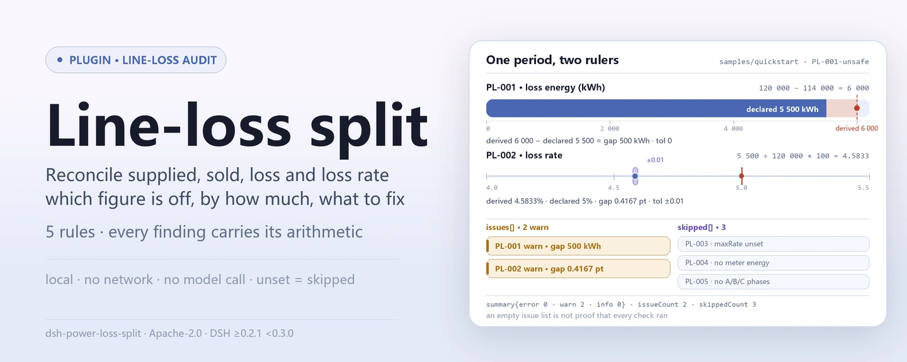

<div align="center">

<picture>
  <source media="(prefers-color-scheme: dark)" srcset="docs/assets/dsh-power-loss-split-hero-en-dark.webp">
  
</picture>

# dsh-power-loss-split

**एक मीटरिंग अवधि की लाइन-हानि के अंक, एक ही बार में साफ़: कौन-सी पंक्ति मेल नहीं खाती, कितना अंतर है और क्या सुधारना है।**

लाइन-हानि टीमों के लिए एक DSH जाँच प्लगइन: यह आपूर्त ऊर्जा, विक्रय ऊर्जा, दर्ज लाइन-हानि ऊर्जा और हानि दर, तथा सामग्री में हो तो मीटरिंग-बिंदुओं की सूची पढ़ता है और अंकगणितीय व अंतराल-जाँच करता है। हर निष्कर्ष के साथ उसके अंक और सह्यता दिए जाते हैं; जो जाँच चल नहीं सकती वह कारण के साथ `skipped` में जाती है।

[इंस्टॉल](#तीन-चरणों-में-शुरुआत) · [कॉन्फ़िगरेशन](#कॉन्फ़िगरेशन) · [FAQ](#faq) · [简体中文](README.md) · [English](README.en.md) · [Español](README.es.md) · [Português](README.pt.md) · [हिन्दी](README.hi.md)

[](LICENSE)
[](#संगतता)
[](https://www.npmjs.com/package/dsh-power-loss-split)
[](https://github.com/PerryLink/dsh-power-loss-split/actions/workflows/ci.yml)
[](#संगतता)

[](https://github.com/PerryLink/dsh-power-loss-split/stargazers)
[](https://www.npmjs.com/package/dsh-power-loss-split)
[](https://dshfind.com/plugins/PerryLink/dsh-power-loss-split?ref=badge)
[](https://securityscorecards.dev/viewer/?uri=github.com/PerryLink/dsh-power-loss-split)
[](https://dsh.market/)
[](https://gitee.com/perrylink/dsh-power-loss-split)

```sh
dsh plugin --profile <name> add dsh-power-loss-split
```

</div>

<sub>सामुदायिक प्लगइन, DeepSeek से असंबद्ध। कैनोनिकल रिपॉज़िटरी: <https://github.com/PerryLink/dsh-power-loss-split> (Gitee एक मिरर है)।</sub>

## यह क्या है

`dsh-power-loss-split` किसी एक लाइन या ट्रांसफार्मर-क्षेत्र की एक मीटरिंग अवधि पढ़ता है — `supplied` (आपूर्त ऊर्जा), `sold` (विक्रय ऊर्जा), `loss` (दर्ज लाइन-हानि ऊर्जा), `lossRate` (दर्ज हानि दर) तथा, सामग्री में हो तो, `meters` मीटरिंग-बिंदुओं की सूची — और इन अंकों पर अंकगणितीय व अंतराल-जाँच करता है: ऊर्जा संतुलन, हानि दर, मीटरिंग-बिंदुओं का जोड़, आपके द्वारा कॉन्फ़िगर की गई हानि-दर पट्टी और तीन-चरण असंतुलन। हर निष्कर्ष के साथ उसमें लगे अंक और सह्यता दिए जाते हैं, ताकि जाँचने वाला जोड़ दोबारा कर सके; जो जाँच चल नहीं सकी वह चुपचाप पास होने के बजाय `skipped` में दर्ज होती है।

```text
सामग्री (JSON / YAML)──power_loss_split──▶ rules/power-loss-split.yaml
                                               │ PL-001 … PL-005
                                               ▼
                            रिपोर्ट: found · expected · fix
                                   skipped[]: नियम id + कारण
```

उपकरण का नाम `power_loss_split` है; सामग्री `file` पथ से या सीधे `material` पाठ से आती है। पूरी गणना होस्ट पर होती है — कोई नेटवर्क नहीं, कोई मॉडल कॉल नहीं।

<picture>
  <source media="(prefers-color-scheme: dark)" srcset="docs/assets/dsh-power-loss-split-flow-v5-dark.svg">
  
</picture>

## तीन चरणों में शुरुआत

1. **इंस्टॉल** (कोई एक चैनल; npm पर `0.3.0` है):

   ```sh
   # git चैनल (नवीनतम main)
   dsh plugin --profile web add github:PerryLink/dsh-power-loss-split
   # npm चैनल (प्रकाशित संस्करण)
   dsh plugin --profile web add dsh-power-loss-split
   # tarball चैनल: इस रेपो में pnpm pack के बाद
   dsh plugin --profile web add ./dsh-power-loss-split-<version>.tgz
   ```

   प्रकाशित पैकेज में `lib/index.mjs` शामिल है; स्रोत checkout के लिए पहले `pnpm install && pnpm run build` चाहिए।

2. **न्यूनतम कॉन्फ़िगरेशन** (डिफ़ॉल्ट चल जाते हैं; नियम-पैक पैकेज के साथ आता है):

   ```yaml
   - insert:
       - id: dsh-power-loss-split
         name: dsh-power-loss-split
         config:
           timeoutMs: 120000
   ```

3. **जाँचें कि काम करता है** (साथ आया नमूना, अपनी सामग्री की ज़रूरत नहीं):

   ```sh
   pnpm install && pnpm run build
   node samples/quickstart/run.mjs
   dsh --profile web --dump-config | grep 'dsh-power-loss-split'
   ```

   अपेक्षित आउटपुट `power_loss_split: 2 issue(s) — error 0, warn 2, info 0` और `skipped: 3`, जो `samples/quickstart/expected/result.json` से मेल खाता है; स्क्रीनशॉट `docs/assets/quickstart.png` में है।

**अनइंस्टॉल**: `dsh plugin --profile web remove dsh-power-loss-split` (या प्रोफ़ाइल patch से वह पंक्ति हटा दें)।

## मुख्य क्षमताएँ

नियम-डेटा कोड से अलग है: `rules/power-loss-split.yaml` बदलने से TypeScript छुए बिना नियम-समुच्चय का संस्करण बदल जाता है।

| नियम | जाँच | गंभीरता | आधार का प्रकार |
|---|---|---|---|
| `PL-001` | आपूर्त − विक्रय = लाइन-हानि ऊर्जा | warn | सिद्धांत से व्युत्पन्न |
| `PL-002` | लाइन-हानि ऊर्जा ÷ आपूर्त × 100 = हानि दर | warn | सिद्धांत से व्युत्पन्न |
| `PL-003` | हानि दर आपकी कॉन्फ़िगर की गई पट्टी में है (डिफ़ॉल्ट रूप से बंद) | info | संस्थागत |
| `PL-004` | मीटरिंग-बिंदुओं का जोड़ दर्ज विक्रय ऊर्जा (या आपूर्त) के बराबर है | warn | सिद्धांत से व्युत्पन्न |
| `PL-005` | तीन-चरण असंतुलन आपकी कॉन्फ़िगर की गई सीमा में है (डिफ़ॉल्ट रूप से बंद) | info | संस्थागत |

- **हर निष्कर्ष अपनी गणना दिखाता है।** पाठ `आपूर्त 1000 kWh − विक्रय 900 kWh = 100 kWh` और जिस दर्ज अंक से तुलना हो रही है, दोनों लिखता है; जो जोड़ दोबारा नहीं कर सकता वह निष्कर्ष को नहीं जाँच सकता, इसलिए गणना हमेशा साथ होती है।
- **जो चल नहीं सकता वह `skipped` में।** बिना कॉन्फ़िगर सीमा, छूटा हुआ फ़ील्ड या तीन से कम चरण-मान नियम को id और कारण के साथ `skipped` में डालते हैं — खाली समस्या-सूची को कभी «कुछ गड़बड़ नहीं» नहीं पढ़ा जा सकता।
- **उद्धरण की कमियाँ बताई जाती हैं।** नियम-पैक उद्धरण नहीं गढ़ता: जब शब्दशः धारा नहीं मिली, `excerpt` यही कहता है और गंभीरता `warn` (सिद्धांत से व्युत्पन्न) या `info` (संस्थागत कॉन्फ़िगरेशन) तक सीमित रहती है। एक परीक्षण पुष्टि करता है कि कोई नियम ऐसा उद्धरण नहीं दावा करता जो उसके पास नहीं है।
- **अंक पढ़ने में उदार।** हज़ार विभाजक, इकाई-प्रत्यय, पूर्ण-चौड़ाई अंक, प्रतिशत और दस-हज़ार इकाइयाँ सभी पढ़ी जाती हैं; उदाहरण-सूची «सामग्री का प्रारूप» में है। गैर-संख्यात्मक कोशिका (`—`, खाली) अनुपस्थित मानी जाती है और प्रभावित जाँच बताती है कि वह क्या नहीं कर सकी।
- **केवल होस्ट।** शुद्ध ESM, कोई नेटिव कोड नहीं, कोई नेटवर्क अनुरोध नहीं, कोई मॉडल कॉल नहीं; उपकरण का पंजीकरण disposer लौटाता है, इसलिए अनलोड करने पर वह हट जाता है।

### उपकरण के पैरामीटर

| तर्क | प्रकार | अर्थ |
|---|---|---|
| `file` | string | सामग्री फ़ाइल का निरपेक्ष पथ (JSON या YAML); `material` के साथ अन्योन्याश्रित |
| `material` | string | सीधा सामग्री पाठ (JSON या YAML); `file` के साथ अन्योन्याश्रित |
| `rulesFile` | string | कॉन्फ़िगर किए गए नियम-पैक पथ को बदलता है (पैकेज के सापेक्ष या निरपेक्ष) |
| `only` | string[] | केवल ये नियम चलाएँ; खाली होने पर सभी चलते हैं |

## एक वास्तविक आउटपुट

नीचे दिया गया आउटपुट इस प्लगइन के अपने `PL-002` फ़िक्स्चर पर वास्तविक चलाने से आया है, कोई नकली चित्र नहीं। नियम-पैक उद्धरण नहीं गढ़ता, इसलिए हर निष्कर्ष लागू धारा का नाम और यह भी बताता है कि उसका मूल पाठ इस बार प्राप्त नहीं हुआ।

**उपकरण** `power_loss_split`

**इनपुट**

~~~json
{"name":"10kV 某某线","supplied":120000,"sold":114000,"loss":6000,"lossRate":4.2}
~~~

**आउटपुट**

~~~json
{
  "id": "dsh-power-loss-split.PL-002.f0566556",
  "ruleId": "PL-002",
  "severity": "warn",
  "locator": {
    "column": "线损率"
  },
  "found": "线损电量 6000 kWh ÷ 供电量 120000 kWh × 100% = 5%，与填报的线损率 4.2% 相差 0.8 个百分点",
  "expected": "线损率应为线损电量与供电量之比，允许偏差 0.01 个百分点",
  "fix": "核对线损率的计算口径（分母是否为供电量、是否含无损电量）；本条只做除法核对"
}
~~~

*Observed from `dsh-power-loss-split/tests/fixtures/PL-002/PL-002-unsafe.json (cases.json expects 1×PL-002); executed parseMaterial+runCheck, checkedAt=2026-10-06T00:00:00.000Z`*

नीचे दी गई तालिका उदाहरण-समुच्चय है: पहली पंक्ति विस्तृत केस है, बाकी संक्षिप्त केस हैं।

| आपका सवाल | इसका जवाब |
|---|---|
| दर्ज लाइन-हानि ऊर्जा, आपूर्त − विक्रय से मेल नहीं खाती। तीनों में से कौन-सा अंक गलत है? | `PL-001` यह नहीं बताएगा। यह अंतर दर्ज करता है — `आपूर्त 1000 kWh − विक्रय 900 kWh = 100 kWh`, दर्ज 50 kWh से 50 kWh का अंतर — और उसकी तुलना `toleranceKwh` से करता है, जो 0 पर आती है, यानी तीनों अंक बिल्कुल बराबर होने चाहिए (दस-हज़ार kWh में रिपोर्ट करने पर पूर्णांकन का अंतर रहता है, तब शून्य से भिन्न सह्यता कॉन्फ़िगर करें)। नियम केवल घटाव करता है: यह नहीं तय करता कि कौन-सा मान सही है और यह भी नहीं देखता कि रीडिंग एक ही अवधि की हैं (रीडिंग की समकालिकता)। |
| हानि दर 5.00% भरी है, पर लाइन-हानि ऊर्जा ÷ आपूर्त से 6.25% आता है। क्या गड़बड़ी हर में है? | `PL-002` भाग दिखाता है: लाइन-हानि ऊर्जा ÷ आपूर्त × 100 निकालकर दर्ज दर से अंतर प्रतिशत-बिंदुओं में दर्ज करता है, पूर्णांकन के लिए डिफ़ॉल्ट `tolerancePoints` 0.01 प्रतिशत-बिंदु की छूट के साथ — पूर्णांकन के नियम अलग से GB/T 8170-2008 से उद्धृत हैं, जिसका शब्दशः पाठ इस पैक के पास भी नहीं है। यह नहीं आँकता कि हर का दायरा सही है या नहीं (जैसे कि हानि-रहित ऊर्जा घटाई जानी चाहिए या नहीं): यह सामग्री में बताना या कॉन्फ़िगर करना आपके हाथ है। |
| मेरी लाइन की हानि दर मुझे ऊँची लगती है। क्या उपकरण इसे दर्ज करेगा? | अपने आप नहीं। `PL-003` हानि दर की तुलना केवल उस पट्टी से करता है जो आप कॉन्फ़िगर करें (`minRate` / `maxRate`); दोनों 0 पर आती हैं यानी कॉन्फ़िगर नहीं हैं, और तब यह नियम कारण के साथ `skipped` में दर्ज होता है, चुपचाप पास होने के बजाय। कॉन्फ़िगर होने पर भी यह `info` तक सीमित है: निष्कर्ष का अर्थ है कि दर आपकी तय पट्टी से बाहर है, यह नहीं कि हानि असामान्य है। मूल्यांकन लक्ष्य आपकी संस्था प्रति लाइन, प्रति वर्ष देती है, इसलिए कोई मान ठहराया नहीं गया। |
| मीटरिंग-बिंदुओं की सूची का जोड़ दर्ज विक्रय ऊर्जा से कम है। क्या कोई मीटरिंग बिंदु छूट गया है? | `PL-004` केवल अंतर दर्ज करता है: जिन मीटरिंग बिंदुओं में ऊर्जा का मान है उन्हें जोड़कर दर्ज विक्रय ऊर्जा से मिलाता है — विक्रय अंक न हो तो आपूर्त से —, सह्यता `toleranceKwh` (डिफ़ॉल्ट 0) के साथ। बिंदु छूटना, दो बार गिना जाना और रीडिंग का समकालिक न होना — तीनों एक ही अंतर पैदा करते हैं, इसलिए कारण हाथ से जाँचना पड़ता है; नियम केवल जोड़ करता है। |
| शीट में केवल A और B चरण के मान हैं। असंतुलन की जाँच क्या करती है? | `PL-005` स्वयं को `skipped` में दर्ज करता है: इसे A, B और C नाम के मीटरिंग बिंदु चाहिए, और तीन से कम चरण-मान होने पर यह चल नहीं सकता। तीनों होने पर भी सीमा `maxUnbalancePercent` कॉन्फ़िगर नहीं है (0) और नियम फिर `skipped` में जाता है। सीमा तय करने पर यह (अधिकतम − न्यूनतम) ÷ अधिकतम निकालता है, वह सूत्र निष्कर्ष के साथ दिखाता है, और `info` तक सीमित रहता है: यह नहीं आँकता कि असंतुलन कोई दोष है या नहीं। |

## नियम और आधार

| दस्तावेज़ | संख्यांक | इन्हें उद्धृत करने वाले नियम |
|---|---|---|
| विद्युत नेटवर्क में ऊर्जा-हानि की गणना का मार्गदर्शन | DL/T 686-2018 | PL-001, PL-002, PL-003, PL-004, PL-005 |
| संख्यात्मक मानों के पूर्णांकन और सीमा-मानों के निर्धारण के नियम | GB/T 8170-2008 | PL-002 |

**सीमा:** यह प्लगइन एक मीटरिंग अवधि के लाइन-हानि अंकों पर **अंकगणितीय और अंतराल-जाँच** करता है — ऊर्जा संतुलन, हानि दर, मीटरिंग-बिंदुओं का जोड़, चरण असंतुलन — और हर निष्कर्ष में अपनी गणना दिखाता है। यह मापन-उपकरण या मापन-दोष निदान उपकरण नहीं है (कोई प्रोब नहीं, कोई AMI एकीकरण नहीं, कोई हार्डवेयर मॉडल नहीं) और यह नहीं तय करता कि हानि का अंक उचित है या नहीं, या छेड़छाड़ हुई या नहीं। यह स्प्रेडशीट निर्यात पढ़कर बताता है कि कौन-से जोड़ मेल नहीं खाते।

> ### ⚠️ रिपोर्ट के किसी उद्धरण पर भरोसा करने से पहले यह पढ़ें
>
> **इस प्लगइन के नियम-पैक का हर `excerpt` स्पष्ट शब्दों में कहता है कि धारा का मूल पाठ इस बार प्राप्त नहीं हुआ।** प्लगइन जिन दो संबंधों की जाँच करता है — लाइन-हानि ऊर्जा = आपूर्त − विक्रय और हानि दर = लाइन-हानि ऊर्जा ÷ आपूर्त × 100 — वे **परिभाषात्मक** हैं, और उनका मानक घर **DL/T 686-2018, विद्युत नेटवर्क में ऊर्जा-हानि की गणना का मार्गदर्शन** है। वह मानक **प्रभावी** है, और उसकी विषय-सूची सत्यापित हुई (अध्याय 3 पारिभाषिक शब्द और परिभाषाएँ है, अध्याय 8 विद्युत नेटवर्क में ऊर्जा-हानि का विश्लेषण और हानि-कमी उपायों के प्रभाव की गणना), पर **उसका मूल पाठ निःशुल्क प्रकाशित नहीं है**, इसलिए कोई शब्दशः धारा नहीं पढ़ी जा सकी।
>
> उद्धरण का रूपांतरण करने के बजाय यह पैक कमी को सीधे `excerpt` फ़ील्ड में लिखता है और ईमानदार तर्क `note` में रखता है। इसलिए सब कुछ `warn` (सिद्धांत से व्युत्पन्न) या `info` (स्थानीय रूप से कॉन्फ़िगर) तक सीमित है, और एक परीक्षण पुष्टि करता है कि कोई नियम ऐसा उद्धरण नहीं दावा करता जो उसके पास नहीं है। **मानक का पाठ मिलने पर दो काम करने होंगे: हर `excerpt` को वास्तविक धारा से बदलें और `kind` को `direct` तक बढ़ाएँ।** तब तक एक निष्कर्ष का अर्थ है «ये दो अंक मेल नहीं खाते», न कि «आपने कोई मानक तोड़ा»।
>
> **मूल्यांकन की सीमाएँ आपकी हैं, मानक की नहीं।** लाइन-हानि के लक्ष्य उद्यम या उसके वरिष्ठ द्वारा प्रति लाइन, प्रति वर्ष दिए जाते हैं, इसलिए `PL-003` की पट्टी और `PL-005` की असंतुलन-सीमा **खाली** आती हैं, और जो नियम चल नहीं सकता वह चुपचाप पास होने के बजाय `skipped` में यह बताता है।

<details>
<summary>नियमों के स्रोत और लोड-समय सत्यापन</summary>

नियम-डेटा कोड से अलग है: प्रत्येक नियम में दस्तावेज़, संख्या, स्रोत की अपनी क्रमांकन-प्रणाली के अनुसार धारा, शब्दशः उद्धरण और स्रोत URL होता है। लोड-समय पर लागू: उद्धरण कम से कम आठ अक्षरों का वास्तविक उद्धरण हो, और जिस जाँच का आधार केवल सामान्य सिद्धांत (`kind: derived-from-principle`, अधिकतम `warn`) या स्थानीय नीति (`kind: institutional-configuration`, अधिकतम `info`) हो, उसे कभी `error` घोषित न किया जाए। अपने आधार को बढ़ा-चढ़ाकर बताने वाला नियम-पैक लोड पर विफल होता है, न कि कोई प्रभावशाली दिखने वाली रिपोर्ट बनाता है।

सत्यापित सीमाएँ और जान-बूझकर **न** कहे गए निष्कर्ष साथ आए `rules/evidence/` निर्देशिका में हैं; हर नियम की `note` उस नियम के लिए महत्वपूर्ण हिस्सा दोहराती है।

उद्यम की सीमाएँ **खाली** आती हैं (0 = कॉन्फ़िगर नहीं)। बिना सीमा वाला नियम स्वयं को `skipped` में दर्ज करता है, इसलिए «कोई निष्कर्ष नहीं» कभी चुपचाप «कुछ जाँचा नहीं गया» नहीं हो सकता।

</details>

## सामग्री का प्रारूप

उपकरण JSON या YAML स्वीकार करता है:

```yaml
name: 10kV 某某线
supplied: 120000      # आपूर्त ऊर्जा, kWh
sold: 114000          # विक्रय ऊर्जा, kWh
loss: 6000            # लाइन-हानि ऊर्जा, kWh
lossRate: 5           # हानि दर, %
meters:
  - { 名称: 1号配变, 电量: 60000 }
  - { 名称: 2号配变, 电量: 54000 }
  - { 名称: A, 电量: 100 }      # A/B/C पंक्तियाँ PL-005 चलाती हैं
  - { 名称: B, 电量: 98 }
  - { 名称: C, 电量: 96 }
```

अंक स्ट्रिंग से भी पढ़े जाते हैं, इसलिए स्प्रेडशीट निर्यात जैसा है वैसा ही काम करता है। ये उदाहरण पढ़े जाते हैं:

```text
1,200.5   1200 kWh   １２３４   5%   12.5万
```

गैर-संख्यात्मक कोशिका (`—`, खाली) बस अनुपस्थित होती है, और प्रभावित जाँच बताती है कि वह क्या नहीं कर सकी। पढ़ने की परत में फ़ील्ड वैकल्पिक हैं और जाँच इंजन उन्हें सत्यापित करता है, इसलिए आंशिक निर्यात क्रैश के बजाय «अनुपस्थित» श्रेणी के निष्कर्ष देता है।

## कॉन्फ़िगरेशन

सभी समायोज्य पैरामीटर `src/config.ts` की Schemastery स्कीमा में हैं, इसलिए कोड बदले बिना `cordis.yml` से बदले जा सकते हैं; प्रति-नियम सीमाएँ `rules/` के नियम-पैक में हैं।

| कुंजी | प्रकार | डिफ़ॉल्ट | विवरण |
|---|---|---|---|
| `rulesFile` | string | `rules/power-loss-split.yaml` | नियम-पैक का पथ, पैकेज रूट के सापेक्ष |
| `disabledRules` | string[] | `[]` | बंद करने वाले नियम id; प्रत्येक `skipped` में दिखता है |
| `onlyRules` | string[] | `[]` | केवल ये नियम चलाएँ; खाली होने पर सभी नियम चलते हैं |
| `skipNotes` | string | `""` | हर `skipped` कारण के आगे जोड़ी जाने वाली टिप्पणी |
| `timeoutMs` | number | `120000` | उपकरण का सहकारी समय-सीमा बजट (ms) |

प्रति-नियम पैरामीटर जिन्हें जानना चाहिए:

- `PL-001` / `PL-004` `toleranceKwh` — अनुमत पूर्णांकन छूट। शून्य बिल्कुल बराबरी माँगता है; जब अंक दस-हज़ार kWh में दिए जाएँ और पूर्णांकन लेकर आएँ तो इसे सेट करें।
- `PL-002` `tolerancePoints` — प्रतिशत-बिंदुओं में छूट, डिफ़ॉल्ट `0.01`।
- `PL-003` `minRate` / `maxRate` — इस वर्ष इस लाइन के लिए **आपकी** मूल्यांकन पट्टी। `maxRate` का `0` अर्थ है कि नियम नहीं चलता।
- `PL-005` `maxUnbalancePercent` — इस वोल्टेज-वर्ग के लिए **आपकी** असंतुलन-सीमा। `0` अर्थ है कि नियम नहीं चलता।

प्रोफ़ाइल patch में उदाहरण:

```yaml
- insert:
    - id: dsh-power-loss-split
      name: dsh-power-loss-split
      config:
        disabledRules: [PL-003]
        skipNotes: इस तिमाही केवल ऊर्जा संतुलन मिलाया जा रहा है
```

## FAQ

<details>
<summary>सामग्री और रिपोर्ट कहाँ रहती हैं? कुछ नेटवर्क पर जाता है?</summary>

प्लगइन का **अपना कोई संग्रह नहीं** है: सामग्री केवल इस उपकरण-कॉल के लिए पढ़ी जाती है (`file` पथ या सीधा `material`) और रिपोर्ट उपकरण के परिणाम के रूप में लौटती है; उसके बाद सत्र-रिकॉर्ड होस्ट संभालता है। गणना कोई नेटवर्क अनुरोध नहीं करती और किसी मॉडल को नहीं बुलाती; मूल फ़ाइल कभी नहीं बदली जाती। `package.json` का `dsh.demo` भी `network: false` और `writes: []` घोषित करता है।

</details>

<details>
<summary>रिपोर्ट में कोई समस्या नहीं दिखी — क्या लाइन ठीक है?</summary>

नहीं। पहले `skipped` देखें: बिना कॉन्फ़िगर सीमा (`maxRate: 0`, `maxUnbalancePercent: 0`), छूटा हुआ फ़ील्ड या तीन से कम चरण-मान संबंधित जाँच को कारण के साथ पूरी तरह छोड़ देते हैं। खाली समस्या-सूची का अर्थ केवल «जो जाँचें चलीं उन्हें कोई अंतर नहीं मिला» है, न कि «सभी जाँचें चलीं»।

</details>

<details>
<summary>कोई नियम कभी क्यों नहीं चलता?</summary>

`PL-003` और `PL-005` सीमा 0 के साथ आते हैं, यानी कॉन्फ़िगर नहीं; बिना कॉन्फ़िगर का अर्थ `skipped` है। लाइन-हानि के लक्ष्य संस्था प्रति लाइन, प्रति वर्ष देती है, और असंतुलन-सीमाएँ वोल्टेज-वर्ग व उपकरण-क्षमता के अनुसार तय होती हैं: प्लगइन कोई मान ठहराता नहीं, इसलिए इस वर्ष की पट्टी और इस वोल्टेज-वर्ग की सीमा आपको नियम-पैक या कॉन्फ़िगरेशन में भरनी होगी। `disabledRules` में सूचीबद्ध नियम भी छोड़े जाते हैं और `skipped` में दिखते हैं।

</details>

<details>
<summary>प्रदर्शन पर कितना खर्च है? क्या सत्र रुक सकता है?</summary>

कोई नेटवर्क अनुरोध नहीं, कोई मॉडल कॉल नहीं, कोई regex बैकट्रैकिंग नहीं; खर्च है एक सामग्री-पठन, कुछ अंकगणितीय क्रियाएँ और रिपोर्ट का स्वरूपण। `timeoutMs` उपकरण को दिया जाने वाला सहकारी समय-सीमा बजट है (डिफ़ॉल्ट `120000` ms), और उपकरण होस्ट के abort संकेत का भी पालन करता है। पूरी निर्देशिका के लिए `ptc` टूल-मोड चुनें ताकि स्कीमा का खर्च एक ही बार लगे।

</details>

<details>
<summary>समस्या-निवारण: इंस्टॉल, उपकरण गायब, न चलने वाले नियम</summary>

- **प्लगइन इंस्टॉल हो गया पर उपकरण दिखता नहीं**: जाँचें कि `main` `lib/index.mjs` पर जाता है और `pnpm run build` ने उसे बनाया है; गलत `main` लोडर को प्रविष्टि चुपचाप छोड़ने पर मजबूर करता है।
- **`dsh plugin add` असंगत बताकर मना करता है**: peer रेंज `0.1.x` और `0.2.x` दोनों को कवर करती है; बाहर होने पर स्पष्ट छूट दें: `dsh plugin --profile <name> allow-version <pkg@ver> --dsh-version <runtime> --accept-risk`।
- **कोई नियम नहीं चला**: `skipped` सरणी देखें; वह नियम id और कारण बताती है।
- **`check` में `manifest-peers` विफल दिखता है**: स्थिर जाँचकर्ता 0.2 श्रृंखला से पुरानी कठोर-कोडित peer रेंज से तुलना करता है; इंस्टॉल के समय peer अनुकूलता रनटाइम लागू करता है। यह `dsh-plugin-dev` की ज्ञात अपस्ट्रीम समस्या है।
- **समय खिसका हुआ लगता है**: सारी गणना दिए गए स्ट्रिंग पर वॉल-क्लॉक है; कोई समय-क्षेत्र रूपांतरण नहीं होता।
- **निष्कर्ष कहता है जोड़ मेल नहीं खाता पर शीट सही लगती है**: गणना-अवधि मिलाएँ; आपूर्त अंक से भिन्न तारीख को पढ़ा गया मीटर ठीक वही अंतर पैदा करता है। प्लगइन अंतर बताता है, पर आपका मीटर-रीडिंग कैलेंडर नहीं देख सकता।
- **`PL-002` सही दिखने वाली दर पर चल पड़ता है**: हर आपूर्त ऊर्जा माना जाता है। यदि आपका अंक दूसरा आधार लेता है (जैसे हानि-रहित ऊर्जा घटाकर आपूर्त), तो यह घोषित-दायरे का प्रश्न है, अंकगणित का नहीं — दायरा सामग्री में बताएँ या नियम बंद करें।
- **`PL-003` / `PL-005` कभी नहीं चलते**: उनकी सीमाएँ खाली आती हैं। इस लाइन की मूल्यांकन पट्टी और इस वोल्टेज-वर्ग की असंतुलन-सीमा भरें।

</details>

## सुरक्षा सीमाएँ और ज्ञात सीमाएँ

- **केवल अंकगणितीय और अंतराल-जाँच।** ऊर्जा संतुलन, हानि दर, मीटरिंग-बिंदुओं का जोड़, चरण असंतुलन और हर निष्कर्ष की गणना। यह मापन-उपकरण या मापन-दोष निदान उपकरण नहीं (कोई प्रोब नहीं, कोई AMI एकीकरण नहीं, कोई हार्डवेयर मॉडल नहीं) और यह नहीं आँकता कि हानि का अंक उचित है या छेड़छाड़ हुई।
- **उद्धरण की कमियाँ बताई जाती हैं।** नियम-पैक उद्धरण नहीं गढ़ता; `excerpt` कहता है कि धारा का मूल पाठ प्राप्त नहीं हुआ, और आधार का प्रकार व गंभीरता साक्ष्य से सीमित रहते हैं। एक निष्कर्ष का अर्थ «ये दो अंक मेल नहीं खाते», न कि «आपने मानक तोड़ा»।
- **खाली सूची «सब ठीक» नहीं है।** जो जाँचें नहीं चल सकतीं वे कारण के साथ `skipped` में जाती हैं; «कोई निष्कर्ष नहीं» को «कुछ जाँचा नहीं गया» नहीं पढ़ना चाहिए।
- **मूल्यांकन सीमाएँ आपकी संस्था की हैं।** `minRate` / `maxRate` / `maxUnbalancePercent` 0 पर आती हैं (कॉन्फ़िगर नहीं); प्लगइन कोई लक्ष्य नहीं ठहराता और अनुमान नहीं लगाता।
- **एक अवधि, समकालिकता पर कोई निर्णय नहीं।** केवल वही अवधि जाँची जाती है जो आप देते हैं; रीडिंग एक ही अवधि की हैं या नहीं, और मीटरिंग बिंदु छूटे या दो बार गिने गए या नहीं — यह हाथ से जाँचना पड़ता है।
- **कोई समय-क्षेत्र रूपांतरण नहीं।** सारी गणना दिए गए स्ट्रिंग पर वॉल-क्लॉक है।
- **स्थानीय रूप से चलता है।** कोई नेटवर्क अनुरोध नहीं, कोई क्रेडेंशियल नहीं, मूल सामग्री में वापस नहीं लिखता; पढ़ा गया एकमात्र पथ वही है जो आप `file` में देते हैं।

## अन्य DSH प्लगइनों के साथ इंटरऑपरेबिलिटी

यह प्लगइन ठीक एक उपकरण पंजीकृत करता है, इसलिए उसकी पंजीकरण-सतह संकरी है:

- **एक उपकरण, एक नाम।** यह केवल `power_loss_split` पंजीकृत करता है; किसी अंतर्निहित उपकरण या अन्य प्लगइन के नंगे नाम पर कब्ज़ा नहीं करता।
- **कोई सेवा-कुंजी, HTTP मार्ग या क्लाइंट स्लॉट नहीं।** यह सेवा-कुंजी नहीं देता, कोई `webServer` उपसर्ग पंजीकृत नहीं करता और इसका कोई ब्राउज़र-आधा नहीं है (इस रेपो में `client/` निर्देशिका नहीं है), इसलिए क्लाइंट स्लॉट के लिए प्रतिस्पर्धा नहीं करता।
- **कोई वैश्विक परिवर्तन नहीं।** यह प्रोटोटाइप नहीं पैच करता, `process.env` नहीं लिखता और वैश्विक fetch डिस्पैचर नहीं बदलता।
- **पंजीकरण एक effect है।** `ctx.tools.register` का लौटाया disposer अनलोड/हॉट-रीलोड पर उपकरण हटा देता है; `inject: ['tools']` का अर्थ है कि यह केवल तब लोड होता है जब `tools` सेवा मौजूद हो।

साक्ष्य: `src/index.ts` की पंजीकरण-सतह (`export const inject = ['tools']`, एक ही `ctx.tools.register`, कोई अन्य पंजीकरण नहीं)।

## संगतता

| सतह | स्थिति |
|---|---|
| Harness | peer रेंज `>=0.1.2-rc.1 <0.2.0 \|\| >=0.2.0-0 <0.3.0` — `0.2.0-rc.2` और `0.2.1-rc.2` दोनों को स्वीकार करने के लिए सत्यापित। `engines.dsh` `>=0.2.1-0 <0.3.0` के रूप में घोषित है और 0.2.1 से होस्ट इसे लागू करता है |
| Node | `^22.19.0 \|\| >=24.0.0` |
| प्लेटफ़ॉर्म | सभी (शुद्ध ESM; कोई नेटिव कोड नहीं, कोई नेटवर्क नहीं, कोई मॉडल कॉल नहीं) |
| टूल मोड | `native` और `ptc` में काम करता है; पूरी निर्देशिका के लिए `ptc` चुनें |

## इकोसिस्टम और गुणवत्ता

- [dshfind प्लगइन पेज](https://dshfind.com/plugins/PerryLink/dsh-power-loss-split) (इंस्टॉल और रैंकिंग)
- [OpenSSF Scorecard रिपोर्ट](https://securityscorecards.dev/viewer/?uri=github.com/PerryLink/dsh-power-loss-split) ([.github/workflows/scorecard.yml](.github/workflows/scorecard.yml) से संचालित)
- [DSH Market](https://dsh.market/) (सूचीबद्ध)
- [Gitee मिरर](https://gitee.com/perrylink/dsh-power-loss-split) (सिंक मिरर; GitHub ही कैनोनिकल है)
- [सामग्री के अनुसार जाँचकर्ता चुनें](https://perrylink.github.io/zh/checkers/choose/) (वह जाँचकर्ता-सूचकांक जिसमें यह प्लगइन है)
- [समस्या ट्रैकर](https://github.com/PerryLink/dsh-power-loss-split/issues) (संस्करण, कमांड और न्यूनतम संपादित सामग्री साथ दें)

## डेवलपमेंट

```sh
pnpm install
pnpm run typecheck        # tsc --noEmit
pnpm test                 # vitest, हर नियम के लिए अनुरूप/उल्लंघन फ़िक्स्चर की जोड़ी
pnpm run build            # tsdown -> lib/index.mjs + lib/index.d.mts
pnpm run verify:self-contained
pnpm run check:lockfile
pnpm run check:readmes    # बहुभाषी README की संगति
pnpm run check:citations
node ../scripts/sync-shared.mjs dsh-power-loss-split   # src/shared ताज़ा करें
```

अंतिम कमांड `../_shared` का साझा किट `src/shared/` में कॉपी करता है; हर साझा बदलाव के बाद इसे दोबारा चलाएँ। README की छवियाँ [`scripts/gen-readme-assets.py`](scripts/gen-readme-assets.py) से क्रमादेशित रूप से बनती हैं (hero को Pillow zh/en × हल्का/गहरा में बनाता है; संरचना-आरेख हाथ से लिखा गया SVG जोड़ा है) और दोबारा चलाई जा सकती हैं: `python scripts/gen-readme-assets.py`.

<details>
<summary>निर्देशिका संरचना</summary>

| पथ | सामग्री |
|---|---|
| `src/index.ts` | उपकरण पंजीकरण और नियम-पैक का पता लगाना (function-plugin अनुबंध, कोई default export नहीं) |
| `src/config.ts` | Schemastery कॉन्फ़िगरेशन स्कीमा; सभी समायोज्य यहीं हैं |
| `src/check.ts` | शुद्ध जाँच-कोर `(input, ruleset, options) => Report`; कोई I/O, घड़ी या मॉडल नहीं |
| `src/parse.ts` | JSON / YAML सामग्री पाठक |
| `src/view.ts` | मॉडल के लिए रिपोर्ट प्रक्षेपण; `output.schema` उसे दर्शाता है |
| `src/shared/` | साझा किट (ruleset लोडर, रिपोर्ट आकार, YAML उपसमुच्चय, तिथि अंकगणित), आयात नहीं बल्कि प्रतिलिपि |
| `rules/power-loss-split.yaml` | 5-नियम पैक |
| `rules/evidence/` | हर उद्धरण का सत्यापन-रिकॉर्ड |
| `tests/` | vitest; हर नियम के `tests/fixtures/<RULE>/` में जोड़ी फ़िक्स्चर |
| `scripts/` | यांत्रिक द्वार: आत्मनिर्भरता, lockfile विचलन, README संगति, उद्धरण |

</details>

Topics: `dsh`, `dsh-plugin`, `deepseek-harness`, `deepseek`, `cordis`, `power`, `loss`, `split`

## परिवार और आभार

यह परियोजना [PerryLink](https://github.com/PerryLink) की DeepSeek Harness प्लगइन-फ़ैमिली का हिस्सा है (सभी Apache-2.0)। पूरा सूचकांक [सामग्री के अनुसार जाँचकर्ता चुनें](https://perrylink.github.io/zh/checkers/choose/) और [सभी प्लगइन](https://github.com/PerryLink) में है; यह रेपो उनमें से एक है। अगर यह उपयोगी लगे, **एक स्टार अगले व्यक्ति को इसे खोजने में मदद करता है** — उससे कोई सुविधा खुलती नहीं।

- [@PerryLink](https://github.com/PerryLink) — निर्माता और अनुरक्षक: नियम-पैक, जाँच-कोर, पाँच-भाषा दस्तावेज़ और छवि स्क्रिप्ट।

<details>
<summary>सभी प्लगइन विस्तृत करें</summary>

| प्लगइन | स्थिति |
|---|---|
| **[dsh-aqua-input-check](https://github.com/PerryLink/dsh-aqua-input-check)** |  |
| **[dsh-archive-check](https://github.com/PerryLink/dsh-archive-check)** |  |
| **[dsh-auto-review](https://github.com/PerryLink/dsh-auto-review)** |  |
| **[dsh-autotier](https://github.com/PerryLink/dsh-autotier)** | 🧊 फ़्रोज़न — रेपो README देखें |
| **[dsh-bid-ca-precheck](https://github.com/PerryLink/dsh-bid-ca-precheck)** |  |
| **[dsh-bid-qual-check](https://github.com/PerryLink/dsh-bid-qual-check)** |  |
| **[dsh-cert-mcp](https://github.com/PerryLink/dsh-cert-mcp)** | 🧊 फ़्रोज़न — रेपो README देखें |
| **[dsh-checkpoint-rewind](https://github.com/PerryLink/dsh-checkpoint-rewind)** |  |
| **[dsh-click](https://github.com/PerryLink/dsh-click)** |  |
| **[dsh-composer-history](https://github.com/PerryLink/dsh-composer-history)** |  |
| **[dsh-contract-stance](https://github.com/PerryLink/dsh-contract-stance)** |  |
| **[dsh-customs-doc-check](https://github.com/PerryLink/dsh-customs-doc-check)** |  |
| **[dsh-data-quality](https://github.com/PerryLink/dsh-data-quality)** |  |
| **[dsh-demurrage-ledger](https://github.com/PerryLink/dsh-demurrage-ledger)** |  |
| **[dsh-doublecheck](https://github.com/PerryLink/dsh-doublecheck)** |  |
| **[dsh-drill-script-check](https://github.com/PerryLink/dsh-drill-script-check)** |  |
| **[dsh-eia-guide-check](https://github.com/PerryLink/dsh-eia-guide-check)** |  |
| **[dsh-emergency-plan](https://github.com/PerryLink/dsh-emergency-plan)** |  |
| **[dsh-essay-rubric-check](https://github.com/PerryLink/dsh-essay-rubric-check)** |  |
| **[dsh-evidence-check](https://github.com/PerryLink/dsh-evidence-check)** |  |
| **[dsh-export-ctl-check](https://github.com/PerryLink/dsh-export-ctl-check)** |  |
| **[dsh-fast](https://github.com/PerryLink/dsh-fast)** |  |
| **[dsh-fmea-table-check](https://github.com/PerryLink/dsh-fmea-table-check)** |  |
| **[dsh-forecast-penalty](https://github.com/PerryLink/dsh-forecast-penalty)** |  |
| **[dsh-fund-research](https://github.com/PerryLink/dsh-fund-research)** |  |
| **[dsh-github](https://github.com/PerryLink/dsh-github)** |  |
| **[dsh-gongwen-flow-check](https://github.com/PerryLink/dsh-gongwen-flow-check)** |  |
| **[dsh-gongwen-word-check](https://github.com/PerryLink/dsh-gongwen-word-check)** |  |
| **[dsh-guard-plan-qc](https://github.com/PerryLink/dsh-guard-plan-qc)** |  |
| **[dsh-hazchem-check](https://github.com/PerryLink/dsh-hazchem-check)** |  |
| **[dsh-hazplan-check](https://github.com/PerryLink/dsh-hazplan-check)** |  |
| **[dsh-hidden-risk-map](https://github.com/PerryLink/dsh-hidden-risk-map)** |  |
| **[dsh-hs-classify](https://github.com/PerryLink/dsh-hs-classify)** |  |
| **[dsh-icd-rule-check](https://github.com/PerryLink/dsh-icd-rule-check)** |  |
| **[dsh-industry-research](https://github.com/PerryLink/dsh-industry-research)** |  |
| **[dsh-lawcite-adapter](https://github.com/PerryLink/dsh-lawcite-adapter)** |  |
| **[dsh-laya](https://github.com/PerryLink/dsh-laya)** |  |
| **[dsh-lc-doc-check](https://github.com/PerryLink/dsh-lc-doc-check)** |  |
| **[dsh-learning-gap-check](https://github.com/PerryLink/dsh-learning-gap-check)** |  |
| **[dsh-library](https://github.com/PerryLink/dsh-library)** |  |
| **[dsh-local-ai](https://github.com/PerryLink/dsh-local-ai)** |  |
| **[dsh-lsp-actions](https://github.com/PerryLink/dsh-lsp-actions)** |  |
| **[dsh-mask](https://github.com/PerryLink/dsh-mask)** |  |
| **[dsh-mcp-panel](https://github.com/PerryLink/dsh-mcp-panel)** |  |
| **[dsh-medrec-qc](https://github.com/PerryLink/dsh-medrec-qc)** |  |
| **[dsh-memento](https://github.com/PerryLink/dsh-memento)** |  |
| **[dsh-nsfc-form-check](https://github.com/PerryLink/dsh-nsfc-form-check)** |  |
| **[dsh-nurse-record-check](https://github.com/PerryLink/dsh-nurse-record-check)** |  |
| **[dsh-observe](https://github.com/PerryLink/dsh-observe)** |  |
| **[dsh-origin-rvc-check](https://github.com/PerryLink/dsh-origin-rvc-check)** |  |
| **[dsh-ota-review-check](https://github.com/PerryLink/dsh-ota-review-check)** |  |
| **[dsh-output-styles](https://github.com/PerryLink/dsh-output-styles)** |  |
| **[dsh-paper-doc-adapter](https://github.com/PerryLink/dsh-paper-doc-adapter)** |  |
| **[dsh-permission-rules](https://github.com/PerryLink/dsh-permission-rules)** |  |
| **[dsh-permit-report-check](https://github.com/PerryLink/dsh-permit-report-check)** |  |
| **[dsh-pipeline-check](https://github.com/PerryLink/dsh-pipeline-check)** |  |
| **[dsh-pleading-draft](https://github.com/PerryLink/dsh-pleading-draft)** |  |
| **[dsh-plugin-doctor](https://github.com/PerryLink/dsh-plugin-doctor)** | 🚫 रिटायर्ड (रेपो संग्रहीत) |
| **[dsh-plugin-guide](https://github.com/PerryLink/dsh-plugin-guide)** |  |
| **[dsh-plugin-kit](https://github.com/PerryLink/dsh-plugin-kit)** | 🚫 रिटायर्ड (रेपो संग्रहीत) |
| **[dsh-plugin-upgrade](https://github.com/PerryLink/dsh-plugin-upgrade)** | 🚫 रिटायर्ड (रेपो संग्रहीत) |
| **[dsh-policy-brief-draft](https://github.com/PerryLink/dsh-policy-brief-draft)** |  |
| **[dsh-power-loss-split](https://github.com/PerryLink/dsh-power-loss-split)** |  |
| **[dsh-power-ticket-check](https://github.com/PerryLink/dsh-power-ticket-check)** |  |
| **[dsh-ppap-check](https://github.com/PerryLink/dsh-ppap-check)** |  |
| **[dsh-protest-deadline](https://github.com/PerryLink/dsh-protest-deadline)** |  |
| **[dsh-railway-window](https://github.com/PerryLink/dsh-railway-window)** |  |
| **[dsh-repair-order-qc](https://github.com/PerryLink/dsh-repair-order-qc)** |  |
| **[dsh-research-report](https://github.com/PerryLink/dsh-research-report)** |  |
| **[dsh-review-reply-check](https://github.com/PerryLink/dsh-review-reply-check)** |  |
| **[dsh-rulefile-check](https://github.com/PerryLink/dsh-rulefile-check)** |  |
| **[dsh-safety-brief-check](https://github.com/PerryLink/dsh-safety-brief-check)** |  |
| **[dsh-score](https://github.com/PerryLink/dsh-score)** |  |
| **[dsh-session-sync](https://github.com/PerryLink/dsh-session-sync)** |  |
| **[dsh-site-log-check](https://github.com/PerryLink/dsh-site-log-check)** |  |
| **[dsh-skill-pack-security](https://github.com/PerryLink/dsh-skill-pack-security)** |  |
| **[dsh-soe-decision-check](https://github.com/PerryLink/dsh-soe-decision-check)** |  |
| **[dsh-soilwater-check](https://github.com/PerryLink/dsh-soilwater-check)** |  |
| **[dsh-sop-sync-check](https://github.com/PerryLink/dsh-sop-sync-check)** |  |
| **[dsh-spc-gbt-adapter](https://github.com/PerryLink/dsh-spc-gbt-adapter)** |  |
| **[dsh-talk](https://github.com/PerryLink/dsh-talk)** |  |
| **[dsh-tender-extract](https://github.com/PerryLink/dsh-tender-extract)** |  |
| **[dsh-tender-matrix](https://github.com/PerryLink/dsh-tender-matrix)** |  |
| **[dsh-test-drive](https://github.com/PerryLink/dsh-test-drive)** |  |
| **[dsh-ticktick](https://github.com/PerryLink/dsh-ticktick)** | 🚫 रिटायर्ड (रेपो संग्रहीत) |
| **[dsh-translate](https://github.com/PerryLink/dsh-translate)** |  |
| **[dsh-warranty-calc](https://github.com/PerryLink/dsh-warranty-calc)** |  |
| **[dsh-budget](https://github.com/PerryLink/dsh-budget)** | 🧊 फ़्रोज़न — रेपो README देखें |
| **[dsh-claude-move](https://github.com/PerryLink/dsh-claude-move)** | 🧊 फ़्रोज़न — रेपो README देखें |
| **[dsh-defend](https://github.com/PerryLink/dsh-defend)** | 🧊 फ़्रोज़न — रेपो README देखें |
| **[dsh-draw](https://github.com/PerryLink/dsh-draw)** | 🧊 फ़्रोज़न — रेपो README देखें |
| **[dsh-reach](https://github.com/PerryLink/dsh-reach)** | 🧊 फ़्रोज़न — रेपो README देखें |
| **[dsh-background-agents](https://github.com/PerryLink/dsh-background-agents)** | 🚫 रिटायर्ड (रेपो संग्रहीत) |
| **[dsh-session-pin](https://github.com/PerryLink/dsh-session-pin)** | 🚫 रिटायर्ड (रेपो संग्रहीत) |
| **[dsh-team-rooms](https://github.com/PerryLink/dsh-team-rooms)** | 🚫 रिटायर्ड (रेपो संग्रहीत) |

</details>

## लाइसेंस

[LICENSE](LICENSE) (Apache License 2.0) © 2026 dsh-power-loss-split contributors

<p align="center"><sub>Apache-2.0 · सामुदायिक प्लगइन, DeepSeek से असंबद्ध।</sub></p>
