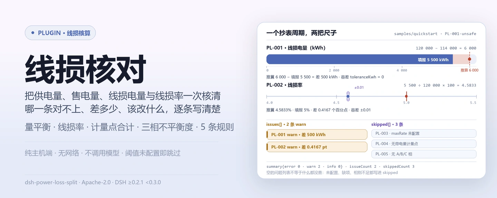
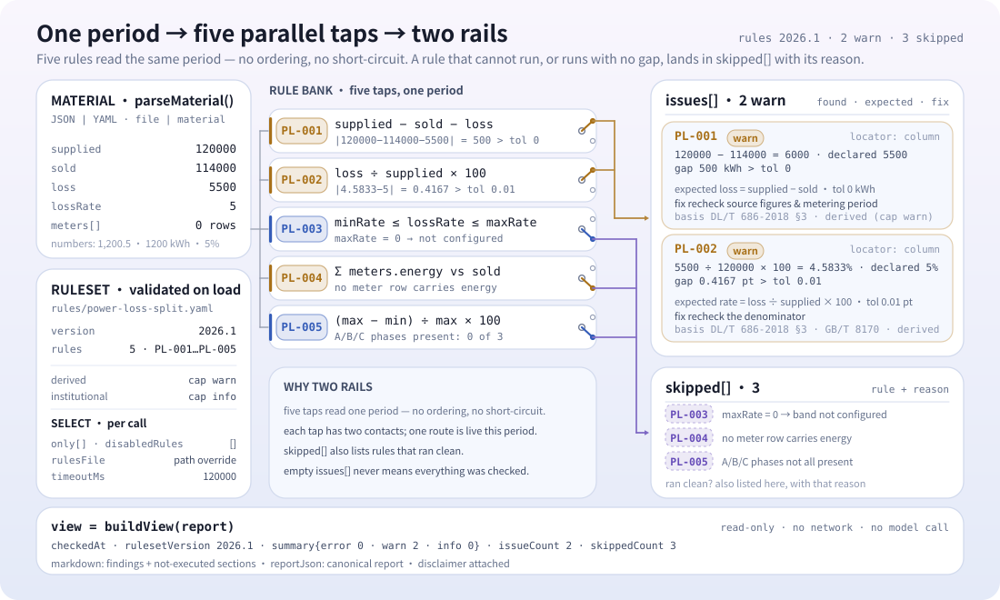

<div align="center">

<picture>
  <source media="(prefers-color-scheme: dark)" srcset="docs/assets/dsh-power-loss-split-hero-zh-dark.webp">
  
</picture>

# dsh-power-loss-split

**一个抄表周期的线损数字，一次算清哪一行对不上、差多少、该改什么。**

面向供电所与线损管理岗的 DSH 核查插件：读取供电量、售电量、线损电量、线损率与计量点清单，做算术与区间核对；每条命中都带算式与容差，跑不起来的检查进 `skipped` 并写明原因。

[安装](#三步上手) · [配置](#配置) · [FAQ](#faq) · [简体中文](README.md) · [English](README.en.md) · [Español](README.es.md) · [Português](README.pt.md) · [हिन्दी](README.hi.md)

[](LICENSE)
[](#兼容性)
[](https://www.npmjs.com/package/dsh-power-loss-split)
[](https://github.com/PerryLink/dsh-power-loss-split/actions/workflows/ci.yml)
[](#兼容性)

[](https://github.com/PerryLink/dsh-power-loss-split/stargazers)
[](https://www.npmjs.com/package/dsh-power-loss-split)
[](https://dshfind.com/plugins/PerryLink/dsh-power-loss-split?ref=badge)
[](https://securityscorecards.dev/viewer/?uri=github.com/PerryLink/dsh-power-loss-split)
[](https://dsh.market/)
[](https://gitee.com/perrylink/dsh-power-loss-split)

```sh
dsh plugin --profile <name> add dsh-power-loss-split
```

</div>

<sub>社区插件，与 DeepSeek 官方无关。唯一仓库：<https://github.com/PerryLink/dsh-power-loss-split>（Gitee 为镜像）。</sub>

## 它是什么

`dsh-power-loss-split` 读取一条线路或一台配变某一个抄表周期的线损材料——`supplied`（供电量）、`sold`（售电量）、`loss`（线损电量）、`lossRate`（线损率），以及材料里有则一并读取的 `meters` 计量点清单——对这些数字做算术与区间核对：量平衡、线损率、计量点合计、你配置的线损率区间、三相不平衡度。每条命中都带着它用到的数字与容差，复核者可以自己重算；凡是跑不起来的检查都列在 `skipped` 里，而不是静默通过。

```text
材料（JSON / YAML）──power_loss_split──▶ rules/power-loss-split.yaml
                                              │ PL-001 … PL-005
                                              ▼
                             报告：found · expected · fix
                                   skipped[]：规则 id + 原因
```

工具名是 `power_loss_split`；材料从 `file` 路径读，或直接用 `material` 内联文本。计算全程在主机端完成，不联网、不调用模型。

<picture>
  <source media="(prefers-color-scheme: dark)" srcset="docs/assets/dsh-power-loss-split-flow-v5-dark.svg">
  
</picture>

## 三步上手

1. **安装**（三选一；npm 已发布 `0.2.10`）：

   ```sh
   # git 通道（最新 main）
   dsh plugin --profile web add github:PerryLink/dsh-power-loss-split
   # npm 通道（已发布版本）
   dsh plugin --profile web add dsh-power-loss-split
   # tarball 通道：本仓库 pnpm pack 后
   dsh plugin --profile web add ./dsh-power-loss-split-<version>.tgz
   ```

   发布包自带构建产物 `lib/index.mjs`；从源码 checkout 使用需先 `pnpm install && pnpm run build`。

2. **最小配置**（默认即可用；规则库随包提供）：

   ```yaml
   - insert:
       - id: dsh-power-loss-split
         name: dsh-power-loss-split
         config:
           timeoutMs: 120000
   ```

3. **验证已生效**（自带样例，无需自己的材料）：

   ```sh
   pnpm install && pnpm run build
   node samples/quickstart/run.mjs
   dsh --profile web --dump-config | grep 'dsh-power-loss-split'
   ```

   期望输出 `power_loss_split: 2 issue(s) — error 0, warn 2, info 0` 与 `skipped: 3`，与 `samples/quickstart/expected/result.json` 一致；样例截图见 `docs/assets/quickstart.png`。

**卸载**：`dsh plugin --profile web remove dsh-power-loss-split`（或从 profile patch 删掉该行）。

## 核心能力

规则数据与代码分离：替换 `rules/power-loss-split.yaml` 即可切换规则集版本，无需改 TypeScript。

| 规则 | 核对内容 | 严重级 | 依据类型 |
|---|---|---|---|
| `PL-001` | 供电量 − 售电量 = 线损电量 | warn | 原则推导 |
| `PL-002` | 线损电量 ÷ 供电量 × 100 = 线损率 | warn | 原则推导 |
| `PL-003` | 线损率落在你配置的区间内（默认关闭） | info | 本机构配置 |
| `PL-004` | 计量点合计等于填报的售电量（或供电量） | warn | 原则推导 |
| `PL-005` | 三相不平衡度在你配置的限值内（默认关闭） | info | 本机构配置 |

- **每条命中都带算式。** 发现文本里直接写 `供电量 1000 kWh − 售电量 900 kWh = 100 kWh，与填报的线损电量 50 kWh 相差 50 kWh`；复核者不能自己重算的发现没有价值，所以算式一定在文本里。
- **跑不起来就进 `skipped`。** 阈值未配置、材料缺字段、相别不足三个，都会带着规则 id 与原因进 `skipped`——空的问题列表不能被读成「没有问题」。
- **引用缺口如实标注。** 规则库不伪造引文：取不到逐字条款时，`excerpt` 直接写明，严重级封顶 `warn`（原则推导）或 `info`（本机构配置），并有测试断言没有任何规则声称拥有它并不拥有的引文。
- **数值读取宽松。** `1,200.5`、`1200 kWh`、全角数字 `１２３４`、`5%`、`12.5万` 都能解析；非数值单元格（`—`、空白）按缺项处理，由受影响的检查自己报告。
- **纯主机端。** 纯 ESM，无原生代码、无网络请求、不调用模型；工具注册返回 disposer，卸载即移除。

### 工具参数

| 参数 | 类型 | 说明 |
|---|---|---|
| `file` | string | 材料文件绝对路径（JSON 或 YAML），与 `material` 二选一 |
| `material` | string | 内联材料文本（JSON 或 YAML），与 `file` 二选一 |
| `rulesFile` | string | 覆盖配置中的规则库路径（相对包根或绝对路径） |
| `only` | string[] | 只执行这些规则 id；留空执行全部 |

## 示例：一次真实输出

下面这条输出来自本插件对 `PL-002` 测试夹具的实际执行，不是示意图。规则库不伪造引文，因此每条发现都会同时写明所引条款，以及该条款原文本次未取得。

**工具** `power_loss_split`

**输入**

~~~json
{"name":"10kV 某某线","supplied":120000,"sold":114000,"loss":6000,"lossRate":4.2}
~~~

**输出**

~~~json
{
  "id": "dsh-power-loss-split.PL-002.f0566556",
  "ruleId": "PL-002",
  "severity": "warn",
  "locator": {
    "column": "线损率"
  },
  "found": "线损电量 6000 kWh ÷ 供电量 120000 kWh × 100% = 5%，与填报的线损率 4.2% 相差 0.8 个百分点",
  "expected": "线损率应为线损电量与供电量之比，允许偏差 0.01 个百分点",
  "fix": "核对线损率的计算口径（分母是否为供电量、是否含无损电量）；本条只做除法核对"
}
~~~

*Observed from `dsh-power-loss-split/tests/fixtures/PL-002/PL-002-unsafe.json (cases.json expects 1×PL-002); executed parseMaterial+runCheck, checkedAt=2026-10-06T00:00:00.000Z`*

下表是示例集：第一行是详细走查，其余行是简短案例。

| 你会问 | 它怎么答 |
|---|---|
| 填报的线损电量与「供电量 − 售电量」对不上，这三个数里哪一个错了？ | `PL-001` 不作判断。它报出差额——`供电量 1000 kWh − 售电量 900 kWh = 100 kWh，与填报的线损电量 50 kWh 相差 50 kWh`——并与容差 `toleranceKwh` 比较；该参数出场为 0，要求三个数严格相等（按万 kWh 报送会留下进位差，此时应配置一个非零容差）。本条只做减法核对：不判断三个数值中哪一个正确，也不核对几次抄表是否同期。 |
| 线损率填的是 5.00%，但线损电量 ÷ 供电量 算出 6.25%，是分母口径的问题吗？ | `PL-002` 会把除法写出来：按 线损电量 ÷ 供电量 × 100 计算，与填报的线损率比较相差几个百分点，默认允许 `tolerancePoints` 0.01 个百分点的四舍五入偏差——修约规则另引 GB/T 8170-2008，该标准本次同样未取得逐字条文。它不判断分母口径是否正确（例如是否应扣除无损电量）：口径问题必须由使用方在材料中说明或配置。 |
| 我这条线路的线损率看着偏高，插件会报出来吗？ | 不会自己报。`PL-003` 只拿线损率与你配置的区间（`minRate` / `maxRate`）比较；两个参数出场均为 0 即未配置，此时本条连同原因列入 `skipped`，而不是静默通过。即使配置了，本条封顶 `info`：命中只表示超出你配置的区间，不表示线损异常。线损考核指标是按线路、按年下达的本机构指标，插件不硬编码任何考核值。 |
| 计量点清单加起来比填报的售电量少，是不是漏了计量点？ | `PL-004` 只报出差额：把带电量数值的计量点相加，与填报的售电量核对——没有售电量时与供电量核对——允许偏差为 `toleranceKwh`（出场为 0）。计量点遗漏、重复计入、抄表不同期都会造成同样的差额，具体原因必须人工核查；本条只做加法核对。 |
| 材料里只有 A 相和 B 相的数值，不平衡度这一条会怎么处理？ | `PL-005` 会把自己列入 `skipped`：它需要按 A、B、C 相命名的计量点，相别数值不足三个就跑不起来。即使三个都有，限值 `maxUnbalancePercent` 出场为 0 即未配置，本条同样进 `skipped`。配置限值后，它按 (最大值 − 最小值) ÷ 最大值 计算，并把这条公式随命中信息一起给出，封顶 `info`——不判断是否构成缺陷。 |

## 规则与依据

| 文件 | 文号 | 引用它的规则 |
|---|---|---|
| 《电力网电能损耗计算导则》 | DL/T 686-2018 | PL-001, PL-002, PL-003, PL-004, PL-005 |
| 《数值修约规则与极限数值的表示和判定》 | GB/T 8170-2008 | PL-002 |

**边界：** 本插件对某一个抄表周期的线损数据做**算术与区间核对**——量平衡、线损率、计量点合计、三相不平衡度——并在每条发现中给出计算过程。它不是计量工具，也不是计量故障排查工具（没有探针、没有 AMI 集成、没有硬件模型），不判定线损数值是否合理，也不判定是否发生篡改。它读取一份电子表格导出，报出哪些合计对不上。

> ### ⚠️ 在相信报告中的引文之前，请先读这一节
>
> **本插件规则库中的每一个 `excerpt` 都明文写着：条款原文本次未取得。** 本插件核对的两个关系式——线损电量 = 供电量 − 售电量 与线损率 = 线损电量 ÷ 供电量 × 100——是**定义性**的，其规范出处是 **DL/T 686-2018《电力网电能损耗计算导则》**。该标准**现行有效**，其目录已核实（第 3 章为术语和定义，第 8 章为电力网电能损耗分析与降损措施效果计算），但**其正文未免费公开**，因此无法读到任何逐字条款。
>
> 本规则库不去转述一段引文，而是直接在 `excerpt` 字段中写明这一缺口，并把诚实的推理放进 `note`。因此所有内容都封顶于 `warn`（原则推导）或 `info`（本机构配置），并且有一项测试断言没有任何规则声称拥有它并不拥有的引文。**待取得标准原文后，必须做两件事：把每个 `excerpt` 换成真实条款，并把 `kind` 提到 `direct`。** 在做到之前，一条发现意味着「这两个数对不上」，而不是「你违反了标准」。
>
> **考核阈值是你的，不是标准的。** 线损指标由企业或其上级按线路、按年下达，因此 `PL-003` 的区间与 `PL-005` 的不平衡度限值出厂为**空**，跑不起来的规则会在 `skipped` 中如实说明，而不是静默通过。

<details>
<summary>规则来源与加载期校验</summary>

规则数据与代码分离，每条规则都带文件名、文号、按原文自身编号体系的条款号、逐字摘录与来源地址。加载期强制：摘录必须是真实引文且不少于八个字符；依据仅为原则性条款（`kind: derived-from-principle`，严重级上限 `warn`）或本机构配置（`kind: institutional-configuration`，上限 `info`）的检查不得标为 `error`。夸大依据的规则库会在加载期失败，而不会产出一份看起来很有底气的报告。

核验中确认的边界与「刻意没有作出的结论」见随包的 `rules/evidence/` 目录；每条规则的 `note` 重复了该条最要紧的那部分说明。

阈值属于企业的，出厂为**空**（0 = 未配置）。未配置阈值的规则会把自己列入 `skipped`，所以「没有问题」永远不会悄悄等于「什么都没查」。

</details>

## 材料格式

工具接受 JSON 或 YAML：

```yaml
name: 10kV 某某线
supplied: 120000      # 供电量 kWh
sold: 114000          # 售电量 kWh
loss: 6000            # 线损电量 kWh
lossRate: 5           # 线损率 %
meters:
  - { 名称: 1号配变, 电量: 60000 }
  - { 名称: 2号配变, 电量: 54000 }
  - { 名称: A, 电量: 100 }      # A/B/C 行驱动 PL-005
  - { 名称: B, 电量: 98 }
  - { 名称: C, 电量: 96 }
```

数字也能从字符串里读，因此电子表格导出的材料可以直接用：`1,200.5`、`1200 kWh`、全角数字 `１２３４`、`5%`、`12.5万` 都能解析。非数值单元格（`—`、空白）按缺项处理，由受影响的检查自己报告它做不了什么。字段在读取层是可选的，由检查引擎校验，因此部分导出的材料会产生「缺项」类差异，而不是让程序崩溃。

## 配置

全部可调参数都在 `src/config.ts` 的 Schemastery schema 中，只改 `cordis.yml` 即可生效，无需改代码；逐条阈值在 `rules/` 下的规则库文件里。

| 键 | 类型 | 默认值 | 说明 |
|---|---|---|---|
| `rulesFile` | string | `rules/power-loss-split.yaml` | 规则库文件路径，相对插件包根目录 |
| `disabledRules` | string[] | `[]` | 要停用的规则 id 列表；每条都会出现在 `skipped` 中 |
| `onlyRules` | string[] | `[]` | 只执行这些规则 id；留空表示执行全部规则 |
| `skipNotes` | string | `""` | 附加到每条 `skipped` 说明后的备注 |
| `timeoutMs` | number | `120000` | 工具协作式超时预算（毫秒） |

规则级参数值得知道：

- `PL-001` / `PL-004` 的 `toleranceKwh`——允许的四舍五入偏差。0 要求严格相等；按万 kWh 报送、存在进位差时应配置一个非零容差。
- `PL-002` 的 `tolerancePoints`——百分点容差，默认 `0.01`。
- `PL-003` 的 `minRate` / `maxRate`——**你**这条线路本年度的考核区间。`maxRate` 为 `0` 表示本条不运行。
- `PL-005` 的 `maxUnbalancePercent`——**你**这个电压等级的不平衡度限值。`0` 表示本条不运行。

profile patch 覆盖示例：

```yaml
- insert:
    - id: dsh-power-loss-split
      name: dsh-power-loss-split
      config:
        disabledRules: [PL-003]
        skipNotes: 本季度只核对量平衡
```

## FAQ

<details>
<summary>材料与报告存在哪里？会不会传到网上？</summary>

插件**没有自己的存储**：材料只在本次工具调用内读取（`file` 路径或 `material` 内联文本），报告作为工具结果返回，随后的会话记录由宿主管理。计算全程无网络请求、不调用模型、不写入材料原件；`package.json` 的 `dsh.demo` 也声明 `network: false`、`writes: []`。

</details>

<details>
<summary>报告里没有问题，就代表这条线路没问题吗？</summary>

不是。先看 `skipped`：阈值未配置（`maxRate: 0`、`maxUnbalancePercent: 0`）、材料缺字段、相别不足三个，都会让对应检查整条跳过并写明原因。空的问题列表只表示「跑起来的检查没有发现差异」，不表示「所有检查都跑过了」。

</details>

<details>
<summary>为什么某条规则从来不运行？</summary>

`PL-003` 与 `PL-005` 的阈值出厂为 0，即未配置；不配置就进 `skipped`。线损考核指标是按线路、按年下达的本机构指标，三相不平衡度限值按电压等级与设备容量分档，插件不硬编码任何值——需要你把本年度、本电压等级的限值填进规则库或配置。`disabledRules` 里列出的规则同样会被跳过并出现在 `skipped` 中。

</details>

<details>
<summary>性能开销多大？会不会卡住会话？</summary>

没有网络请求、没有模型调用、没有正则回溯；开销主要是读取一次材料、几次算术和格式化为报告。`timeoutMs` 是传给工具的协作式超时预算（默认 `120000` 毫秒），工具还会响应宿主的中止信号。批量核对一个目录时建议用 `ptc` 工具模式，schema 成本只付一次。

</details>

<details>
<summary>排错：装不上、工具不出现、某条规则不跑</summary>

- **插件装上了但工具不出现**：确认 `main` 指向 `lib/index.mjs` 且 `pnpm run build` 已生成该文件；`main` 写错会让加载器静默跳过该条目。
- **`dsh plugin add` 报版本不兼容**：peer 范围覆盖 `0.1.x` 与 `0.2.x`；若运行时在其之外，可显式豁免：`dsh plugin --profile <name> allow-version <包名@版本> --dsh-version <runtime> --accept-risk`。
- **某条规则没有执行**：查看 `skipped` 数组，其中写明了规则 id 与原因。
- **`check` 报 `manifest-peers` 失败**：静态检查器比对的是一份早于 0.2 世代的硬编码 peer 范围；安装期的 peer 校验以运行时为准。这是 `dsh-plugin-dev` 的已知上游问题。
- **时间看起来偏移**：全部计算都是对输入字符串做墙上时钟运算，不做时区换算。
- **发现说合计对不上，但表格看着没错**：先比较计算周期——某块表与供电量的抄表日期不同，就会产生一模一样的差额；插件报出差额，但它看不到你的抄表日历。
- **`PL-002` 在看似正确的线损率上命中**：分母按供电量取。若你的口径不同（例如供电量扣除无损电量），那是口径问题而非算术问题——在材料里说明口径，或停用该规则。
- **`PL-003` / `PL-005` 从不运行**：它们的阈值出厂为空，填上这条线路的考核区间与这个电压等级的不平衡度限值即可。

</details>

## 安全边界与已知限制

- **只做算术与区间核对。** 量平衡、线损率、计量点合计、三相不平衡度，以及每条发现的算式。它不是计量工具，也不是计量故障排查工具（没有探针、没有 AMI 集成、没有硬件模型），不判定线损数值是否合理，也不判定是否发生篡改。
- **引用缺口如实披露。** 规则库不伪造引文；`excerpt` 直接写明条款原文本次未取得，依据类型与严重级按证据封顶。一条发现意味着「这两个数对不上」，不是「你违反了标准」。
- **空列表不等于无问题。** 跑不起来的检查进 `skipped` 并带原因；「没有问题」不能被读成「什么都没查」。
- **考核阈值属于本机构。** `minRate` / `maxRate` / `maxUnbalancePercent` 出厂为 0（未配置），插件不硬编码任何考核值；未配置即跳过，不猜测。
- **单周期、不判同期性。** 只核对传入的那一个抄表周期；几次抄表是否同期、计量点是否遗漏或重复计入，需要人工核查。
- **不做时区换算。** 全部计算都是对输入字符串做墙上时钟运算。
- **本地运行。** 无网络请求、无凭据、不写回材料原件；读取的路径就是你在 `file` 里给的那一个。

## 与其他 DSH 插件的互操作性

本插件只注册一个工具，注册面很窄：

- **一个工具、一个命名空间。** 只注册 `power_loss_split`，不占用内置工具或其他插件的裸名。
- **无服务键、无 HTTP 路由、无客户端 slot。** 不提供 service key，不注册 `webServer` 前缀，也没有客户端半（本仓无 `client/` 目录），因此不参与 slot 座位争抢。
- **不改全局。** 不修改原型、不改写 `process.env`、不替换全局 fetch。
- **注册即 effect。** `ctx.tools.register` 返回的 disposer 在卸载/热重载时移除工具；`inject: ['tools']` 意味着只在 `tools` 服务存在时加载。

依据：`src/index.ts` 的注册面（`export const inject = ['tools']`、单个 `ctx.tools.register`、无其他注册调用）。

## 兼容性

| 项目 | 状态 |
|---|---|
| Harness | 对等版本范围 `>=0.1.2-rc.1 <0.2.0 \|\| >=0.2.0-0 <0.3.0` —— 已实测同时接受 `0.2.0-rc.2` 与 `0.2.1-rc.2`。`engines.dsh` 声明为 `>=0.2.1-0 <0.3.0`，自 0.2.1 起由宿主强制 |
| Node | `^22.19.0 \|\| >=24.0.0` |
| 平台 | 全平台（纯 ESM；无原生代码、无联网、不调用模型） |
| 工具模式 | `native` / `ptc` 均可；批量核对整个目录时建议 `ptc`，schema 成本只付一次 |

## 生态与质量

- [dshfind 插件页](https://dshfind.com/plugins/PerryLink/dsh-power-loss-split)（安装量与排名）
- [OpenSSF Scorecard 报告](https://securityscorecards.dev/viewer/?uri=github.com/PerryLink/dsh-power-loss-split)（由 [.github/workflows/scorecard.yml](.github/workflows/scorecard.yml) 驱动）
- [DSH Market](https://dsh.market/)（已上架）
- [Gitee 镜像](https://gitee.com/perrylink/dsh-power-loss-split)（同步镜像，以 GitHub 为准）
- [按材料选核查器](https://perrylink.github.io/zh/checkers/choose/)（本插件所属的核查器索引）
- [问题反馈](https://github.com/PerryLink/dsh-power-loss-split/issues)（附版本、命令与最小化脱敏材料）

## 开发

```sh
pnpm install
pnpm run typecheck        # tsc --noEmit
pnpm test                 # vitest，每条规则一对合规/违规夹具
pnpm run build            # tsdown -> lib/index.mjs + lib/index.d.mts
pnpm run verify:self-contained
pnpm run check:lockfile
pnpm run check:readmes    # 多语 README 一致性
pnpm run check:citations
node ../scripts/sync-shared.mjs dsh-power-loss-split   # 刷新 src/shared
```

最后的 `sync-shared` 命令把 `../_shared` 的共享件同步进 `src/shared/`；每次改动共享件后都要重跑。配图由 [`scripts/gen-readme-assets.py`](scripts/gen-readme-assets.py) 程序化生成（hero 横幅用 Pillow，zh / en × 深浅共四张；结构图是手写 SVG，深浅双版），可重复执行：`python scripts/gen-readme-assets.py`。

<details>
<summary>目录布局</summary>

| 路径 | 内容 |
|---|---|
| `src/index.ts` | 工具注册与规则库定位（function-plugin 契约，无 default export） |
| `src/config.ts` | Schemastery 配置 schema，所有可调项都在这里 |
| `src/check.ts` | 纯核对核心 `(input, ruleset, options) => Report`，无 I/O、无时钟、无模型 |
| `src/parse.ts` | JSON / YAML 材料读取 |
| `src/view.ts` | 面向模型的报告投影；`output.schema` 与它对应 |
| `src/shared/` | 共享件（规则库加载、报告形状、YAML 子集、日期算术），随包复制而非外部导入 |
| `rules/power-loss-split.yaml` | 5 条规则的规则库 |
| `rules/evidence/` | 每条引用的核查记录 |
| `tests/` | vitest；每条规则在 `tests/fixtures/<RULE>/` 下有合规/违规夹具 |
| `scripts/` | 机械门禁：自包含、锁文件漂移、README 一致性、引用检查 |

</details>

Topics：`dsh`, `dsh-plugin`, `deepseek-harness`, `deepseek`, `cordis`, `power`, `loss`, `split`

## 家族与致谢

本项目是 [PerryLink](https://github.com/PerryLink) 维护的 DeepSeek Harness 插件家族成员（全部 Apache-2.0）。完整清单见 [按材料选核查器](https://perrylink.github.io/zh/checkers/choose/) 与 [全部插件](https://github.com/PerryLink)；本仓只是其中一个。如果这个插件帮到了你，**给个 star**——它不解锁任何功能，但会让下一个人更容易找到它。

- [@PerryLink](https://github.com/PerryLink) —— 创建者与维护者：规则库、核对核心、五语文档与配图脚本。

<details>
<summary>展开全部插件</summary>

| 插件 | 状态 |
|---|---|
| **[dsh-aqua-input-check](https://github.com/PerryLink/dsh-aqua-input-check)** |  |
| **[dsh-archive-check](https://github.com/PerryLink/dsh-archive-check)** |  |
| **[dsh-auto-review](https://github.com/PerryLink/dsh-auto-review)** |  |
| **[dsh-autotier](https://github.com/PerryLink/dsh-autotier)** | 🧊 已冻结 — 见仓库 README |
| **[dsh-bid-ca-precheck](https://github.com/PerryLink/dsh-bid-ca-precheck)** |  |
| **[dsh-bid-qual-check](https://github.com/PerryLink/dsh-bid-qual-check)** |  |
| **[dsh-cert-mcp](https://github.com/PerryLink/dsh-cert-mcp)** | 🧊 已冻结 — 见仓库 README |
| **[dsh-checkpoint-rewind](https://github.com/PerryLink/dsh-checkpoint-rewind)** |  |
| **[dsh-click](https://github.com/PerryLink/dsh-click)** |  |
| **[dsh-composer-history](https://github.com/PerryLink/dsh-composer-history)** |  |
| **[dsh-contract-stance](https://github.com/PerryLink/dsh-contract-stance)** |  |
| **[dsh-customs-doc-check](https://github.com/PerryLink/dsh-customs-doc-check)** |  |
| **[dsh-data-quality](https://github.com/PerryLink/dsh-data-quality)** |  |
| **[dsh-demurrage-ledger](https://github.com/PerryLink/dsh-demurrage-ledger)** |  |
| **[dsh-doublecheck](https://github.com/PerryLink/dsh-doublecheck)** |  |
| **[dsh-drill-script-check](https://github.com/PerryLink/dsh-drill-script-check)** |  |
| **[dsh-eia-guide-check](https://github.com/PerryLink/dsh-eia-guide-check)** |  |
| **[dsh-emergency-plan](https://github.com/PerryLink/dsh-emergency-plan)** |  |
| **[dsh-essay-rubric-check](https://github.com/PerryLink/dsh-essay-rubric-check)** |  |
| **[dsh-evidence-check](https://github.com/PerryLink/dsh-evidence-check)** |  |
| **[dsh-export-ctl-check](https://github.com/PerryLink/dsh-export-ctl-check)** |  |
| **[dsh-fast](https://github.com/PerryLink/dsh-fast)** |  |
| **[dsh-fmea-table-check](https://github.com/PerryLink/dsh-fmea-table-check)** |  |
| **[dsh-forecast-penalty](https://github.com/PerryLink/dsh-forecast-penalty)** |  |
| **[dsh-fund-research](https://github.com/PerryLink/dsh-fund-research)** |  |
| **[dsh-github](https://github.com/PerryLink/dsh-github)** |  |
| **[dsh-gongwen-flow-check](https://github.com/PerryLink/dsh-gongwen-flow-check)** |  |
| **[dsh-gongwen-word-check](https://github.com/PerryLink/dsh-gongwen-word-check)** |  |
| **[dsh-guard-plan-qc](https://github.com/PerryLink/dsh-guard-plan-qc)** |  |
| **[dsh-hazchem-check](https://github.com/PerryLink/dsh-hazchem-check)** |  |
| **[dsh-hazplan-check](https://github.com/PerryLink/dsh-hazplan-check)** |  |
| **[dsh-hidden-risk-map](https://github.com/PerryLink/dsh-hidden-risk-map)** |  |
| **[dsh-hs-classify](https://github.com/PerryLink/dsh-hs-classify)** |  |
| **[dsh-icd-rule-check](https://github.com/PerryLink/dsh-icd-rule-check)** |  |
| **[dsh-industry-research](https://github.com/PerryLink/dsh-industry-research)** |  |
| **[dsh-lawcite-adapter](https://github.com/PerryLink/dsh-lawcite-adapter)** |  |
| **[dsh-laya](https://github.com/PerryLink/dsh-laya)** |  |
| **[dsh-lc-doc-check](https://github.com/PerryLink/dsh-lc-doc-check)** |  |
| **[dsh-learning-gap-check](https://github.com/PerryLink/dsh-learning-gap-check)** |  |
| **[dsh-library](https://github.com/PerryLink/dsh-library)** |  |
| **[dsh-local-ai](https://github.com/PerryLink/dsh-local-ai)** |  |
| **[dsh-lsp-actions](https://github.com/PerryLink/dsh-lsp-actions)** |  |
| **[dsh-mask](https://github.com/PerryLink/dsh-mask)** |  |
| **[dsh-mcp-panel](https://github.com/PerryLink/dsh-mcp-panel)** |  |
| **[dsh-medrec-qc](https://github.com/PerryLink/dsh-medrec-qc)** |  |
| **[dsh-memento](https://github.com/PerryLink/dsh-memento)** |  |
| **[dsh-nsfc-form-check](https://github.com/PerryLink/dsh-nsfc-form-check)** |  |
| **[dsh-nurse-record-check](https://github.com/PerryLink/dsh-nurse-record-check)** |  |
| **[dsh-observe](https://github.com/PerryLink/dsh-observe)** |  |
| **[dsh-origin-rvc-check](https://github.com/PerryLink/dsh-origin-rvc-check)** |  |
| **[dsh-ota-review-check](https://github.com/PerryLink/dsh-ota-review-check)** |  |
| **[dsh-output-styles](https://github.com/PerryLink/dsh-output-styles)** |  |
| **[dsh-paper-doc-adapter](https://github.com/PerryLink/dsh-paper-doc-adapter)** |  |
| **[dsh-permission-rules](https://github.com/PerryLink/dsh-permission-rules)** |  |
| **[dsh-permit-report-check](https://github.com/PerryLink/dsh-permit-report-check)** |  |
| **[dsh-pipeline-check](https://github.com/PerryLink/dsh-pipeline-check)** |  |
| **[dsh-pleading-draft](https://github.com/PerryLink/dsh-pleading-draft)** |  |
| **[dsh-plugin-doctor](https://github.com/PerryLink/dsh-plugin-doctor)** | 🚫 已退役（仓库已归档） |
| **[dsh-plugin-guide](https://github.com/PerryLink/dsh-plugin-guide)** |  |
| **[dsh-plugin-kit](https://github.com/PerryLink/dsh-plugin-kit)** | 🚫 已退役（仓库已归档） |
| **[dsh-plugin-upgrade](https://github.com/PerryLink/dsh-plugin-upgrade)** | 🚫 已退役（仓库已归档） |
| **[dsh-policy-brief-draft](https://github.com/PerryLink/dsh-policy-brief-draft)** |  |
| **[dsh-power-loss-split](https://github.com/PerryLink/dsh-power-loss-split)** |  |
| **[dsh-power-ticket-check](https://github.com/PerryLink/dsh-power-ticket-check)** |  |
| **[dsh-ppap-check](https://github.com/PerryLink/dsh-ppap-check)** |  |
| **[dsh-protest-deadline](https://github.com/PerryLink/dsh-protest-deadline)** |  |
| **[dsh-railway-window](https://github.com/PerryLink/dsh-railway-window)** |  |
| **[dsh-repair-order-qc](https://github.com/PerryLink/dsh-repair-order-qc)** |  |
| **[dsh-research-report](https://github.com/PerryLink/dsh-research-report)** |  |
| **[dsh-review-reply-check](https://github.com/PerryLink/dsh-review-reply-check)** |  |
| **[dsh-rulefile-check](https://github.com/PerryLink/dsh-rulefile-check)** |  |
| **[dsh-safety-brief-check](https://github.com/PerryLink/dsh-safety-brief-check)** |  |
| **[dsh-score](https://github.com/PerryLink/dsh-score)** |  |
| **[dsh-session-sync](https://github.com/PerryLink/dsh-session-sync)** |  |
| **[dsh-site-log-check](https://github.com/PerryLink/dsh-site-log-check)** |  |
| **[dsh-skill-pack-security](https://github.com/PerryLink/dsh-skill-pack-security)** |  |
| **[dsh-soe-decision-check](https://github.com/PerryLink/dsh-soe-decision-check)** |  |
| **[dsh-soilwater-check](https://github.com/PerryLink/dsh-soilwater-check)** |  |
| **[dsh-sop-sync-check](https://github.com/PerryLink/dsh-sop-sync-check)** |  |
| **[dsh-spc-gbt-adapter](https://github.com/PerryLink/dsh-spc-gbt-adapter)** |  |
| **[dsh-talk](https://github.com/PerryLink/dsh-talk)** |  |
| **[dsh-tender-extract](https://github.com/PerryLink/dsh-tender-extract)** |  |
| **[dsh-tender-matrix](https://github.com/PerryLink/dsh-tender-matrix)** |  |
| **[dsh-test-drive](https://github.com/PerryLink/dsh-test-drive)** |  |
| **[dsh-ticktick](https://github.com/PerryLink/dsh-ticktick)** | 🚫 已退役（仓库已归档） |
| **[dsh-translate](https://github.com/PerryLink/dsh-translate)** |  |
| **[dsh-warranty-calc](https://github.com/PerryLink/dsh-warranty-calc)** |  |
| **[dsh-budget](https://github.com/PerryLink/dsh-budget)** | 🧊 已冻结 — 见仓库 README |
| **[dsh-claude-move](https://github.com/PerryLink/dsh-claude-move)** | 🧊 已冻结 — 见仓库 README |
| **[dsh-defend](https://github.com/PerryLink/dsh-defend)** | 🧊 已冻结 — 见仓库 README |
| **[dsh-draw](https://github.com/PerryLink/dsh-draw)** | 🧊 已冻结 — 见仓库 README |
| **[dsh-reach](https://github.com/PerryLink/dsh-reach)** | 🧊 已冻结 — 见仓库 README |
| **[dsh-background-agents](https://github.com/PerryLink/dsh-background-agents)** | 🚫 已退役（仓库已归档） |
| **[dsh-session-pin](https://github.com/PerryLink/dsh-session-pin)** | 🚫 已退役（仓库已归档） |
| **[dsh-team-rooms](https://github.com/PerryLink/dsh-team-rooms)** | 🚫 已退役（仓库已归档） |

</details>

## License

[LICENSE](LICENSE)（Apache License 2.0）© 2026 dsh-power-loss-split contributors

<p align="center"><sub>Apache-2.0 · 社区插件，与 DeepSeek 无关。</sub></p>
