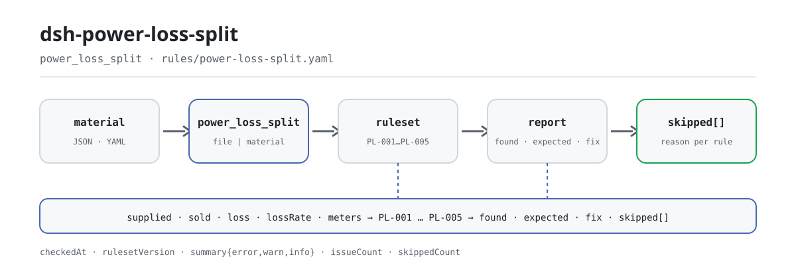

<div align="center">

<picture>
  <source media="(prefers-color-scheme: dark)" srcset="docs/assets/dsh-power-loss-split-flow-dark.svg">
  
</picture>

# dsh-power-loss-split

**Um período de medição de perdas de linha resolvido de uma vez: qual linha não fecha, quanto se desvia e o que corrigir.**

Um verificador DSH para equipes de perdas de linha: lê a energia fornecida, a energia vendida, a energia de perdas declarada e a taxa, mais a lista de pontos de medição quando o material a traz, e aplica verificações aritméticas e de intervalo. Cada achado traz os números e a tolerância usados; toda verificação que não pode ser executada fica em `skipped` com o motivo.

[Instalar](#instalação-em-três-passos) · [Configuração](#configuração) · [FAQ](#faq) · [简体中文](README.md) · [English](README.en.md) · [Español](README.es.md) · [Português](README.pt.md) · [हिन्दी](README.hi.md)

[](LICENSE)
[](#compatibilidade)
[](https://www.npmjs.com/package/dsh-power-loss-split)
[](https://github.com/PerryLink/dsh-power-loss-split/actions/workflows/ci.yml)
[](#compatibilidade)

[](https://github.com/PerryLink/dsh-power-loss-split/stargazers)
[](https://www.npmjs.com/package/dsh-power-loss-split)
[](https://dshfind.com/plugins/PerryLink/dsh-power-loss-split?ref=badge)
[](https://securityscorecards.dev/viewer/?uri=github.com/PerryLink/dsh-power-loss-split)
[](https://dsh.market/)
[](https://gitee.com/perrylink/dsh-power-loss-split)

```sh
dsh plugin --profile <name> add dsh-power-loss-split
```

</div>

<sub>Plugin da comunidade, sem afiliação com a DeepSeek. Repositório canônico: <https://github.com/PerryLink/dsh-power-loss-split> (o Gitee é um espelho).</sub>

## O que é

`dsh-power-loss-split` lê um período de medição de uma linha ou de um posto de transformação — `supplied` (energia fornecida), `sold` (energia vendida), `loss` (energia de perdas declarada), `lossRate` (taxa de perdas declarada) e a lista `meters` quando o material a traz — e faz verificações aritméticas e de intervalo sobre essas cifras: o balanço de energia, a taxa de perdas, a soma dos pontos de medição, a faixa de taxa que você configurar e o desequilíbrio entre fases. Cada achado traz os números e a tolerância utilizados, para que a conta possa ser refeita; toda verificação que não pôde ser executada é listada em `skipped` em vez de passar em silêncio.

```text
material (JSON / YAML)──power_loss_split──▶ rules/power-loss-split.yaml
                                                │ PL-001 … PL-005
                                                ▼
                             relatório: found · expected · fix
                                     skipped[]: id da regra + motivo
```

A ferramenta é `power_loss_split`; o material vem de um caminho `file` ou do texto em linha `material`. Todo o cálculo ocorre no host — sem rede, sem chamada ao modelo.

## Instalação em três passos

1. **Instalar** (escolha um canal; o npm tem `0.2.10`):

   ```sh
   # canal git (main mais recente)
   dsh plugin --profile web add github:PerryLink/dsh-power-loss-split
   # canal npm (versões publicadas)
   dsh plugin --profile web add dsh-power-loss-split
   # canal tarball: após pnpm pack neste repositório
   dsh plugin --profile web add ./dsh-power-loss-split-<version>.tgz
   ```

   O pacote publicado inclui `lib/index.mjs`; um checkout do código-fonte precisa antes de `pnpm install && pnpm run build`.

2. **Configuração mínima** (os padrões servem; o pacote de regras vem incluído):

   ```yaml
   - insert:
       - id: dsh-power-loss-split
         name: dsh-power-loss-split
         config:
           timeoutMs: 120000
   ```

3. **Comprovar que funciona** (exemplo incluído, sem material próprio):

   ```sh
   pnpm install && pnpm run build
   node samples/quickstart/run.mjs
   dsh --profile web --dump-config | grep 'dsh-power-loss-split'
   ```

   Deve sair `power_loss_split: 2 issue(s) — error 0, warn 2, info 0` e `skipped: 3`, igual a `samples/quickstart/expected/result.json`; há uma captura em `docs/assets/quickstart.png`.

**Desinstalar**: `dsh plugin --profile web remove dsh-power-loss-split` (ou remova a linha do patch do perfil).

## Capacidades principais

Os dados das regras ficam separados do código: substituir `rules/power-loss-split.yaml` troca a versão do conjunto de regras sem tocar em TypeScript.

| Regra | Verificação | Gravidade | Tipo de base |
|---|---|---|---|
| `PL-001` | fornecida − vendida = energia de perdas | warn | derivada de princípio |
| `PL-002` | energia de perdas ÷ fornecida × 100 = taxa | warn | derivada de princípio |
| `PL-003` | a taxa cai dentro da faixa configurada (desativada por padrão) | info | institucional |
| `PL-004` | a soma dos pontos de medição iguala a energia vendida declarada (ou a fornecida) | warn | derivada de princípio |
| `PL-005` | o desequilíbrio trifásico respeita o limite configurado (desativado por padrão) | info | institucional |

- **Cada achado mostra sua operação.** O texto escreve `energia fornecida 1000 kWh − vendida 900 kWh = 100 kWh` e a cifra declarada com que se compara; quem não consegue refazer a conta não consegue julgar o achado, por isso a operação está sempre ali.
- **O que não pode rodar vai para `skipped`.** Um limiar não configurado, um campo ausente ou menos de três valores de fase põem a regra em `skipped` com o id e o motivo — uma lista de problemas vazia nunca pode ser lida como «não há nada errado».
- **As lacunas de citação são declaradas.** O pacote de regras não inventa citações: quando o texto literal não pôde ser obtido, `excerpt` diz isso e a gravidade fica limitada a `warn` (derivada de princípio) ou `info` (configuração institucional). Um teste garante que nenhuma regra afirma uma citação que não tem.
- **Leitura de números tolerante.** Separadores de milhar, sufixos de unidade, dígitos de largura total, percentagens e unidades de dez mil são analisados; veja «Formato do material» para a lista de exemplos. Uma célula não numérica (`—`, vazia) é tratada como ausente e a verificação afetada informa o que não pôde fazer.
- **Somente host.** ESM puro, sem código nativo, sem pedidos de rede e sem chamadas ao modelo; o registro da ferramenta devolve um disposer, pelo que descarregá-la a remove.

### Parâmetros da ferramenta

| Argumento | Tipo | Significado |
|---|---|---|
| `file` | string | Caminho absoluto do arquivo de material (JSON ou YAML); exclui `material` |
| `material` | string | Texto de material em linha (JSON ou YAML); exclui `file` |
| `rulesFile` | string | Substitui o caminho configurado do pacote de regras (relativo ao pacote ou absoluto) |
| `only` | string[] | Executar apenas estas regras; vazio executa todas |

## Uma saída real

A saída abaixo vem de uma execução real deste plugin sobre o seu fixture `PL-002`, não é uma simulação. O pacote de regras não inventa citações, por isso cada achado nomeia a cláusula aplicada e avisa que o seu texto não foi obtido desta vez.

**Ferramenta** `power_loss_split`

**Entrada**

~~~json
{"name":"10kV 某某线","supplied":120000,"sold":114000,"loss":6000,"lossRate":4.2}
~~~

**Saída**

~~~json
{
  "id": "dsh-power-loss-split.PL-002.f0566556",
  "ruleId": "PL-002",
  "severity": "warn",
  "locator": {
    "column": "线损率"
  },
  "found": "线损电量 6000 kWh ÷ 供电量 120000 kWh × 100% = 5%，与填报的线损率 4.2% 相差 0.8 个百分点",
  "expected": "线损率应为线损电量与供电量之比，允许偏差 0.01 个百分点",
  "fix": "核对线损率的计算口径（分母是否为供电量、是否含无损电量）；本条只做除法核对"
}
~~~

*Observed from `dsh-power-loss-split/tests/fixtures/PL-002/PL-002-unsafe.json (cases.json expects 1×PL-002); executed parseMaterial+runCheck, checkedAt=2026-10-06T00:00:00.000Z`*

A tabela abaixo é o conjunto de exemplos: a primeira linha é o caso detalhado, as demais são casos curtos.

| Você pergunta | O que ele responde |
|---|---|
| A energia de perdas declarada não fecha com fornecida − vendida. Qual das três cifras está errada? | `PL-001` não o dirá. Reporta a diferença — `fornecida 1000 kWh − vendida 900 kWh = 100 kWh`, 50 kWh de diferença face aos 50 kWh declarados — e compara-a com `toleranceKwh`, que vem em 0, pelo que as três cifras têm de coincidir exatamente (se se declarar em dezenas de milhares de kWh fica uma diferença de arredondamento, e então é preciso configurar uma tolerância diferente de zero). A regra só faz a subtração: não decide qual dos valores está correto nem verifica se as leituras são do mesmo período (sincronia de leituras). |
| A taxa de perdas está preenchida como 5,00%, mas energia de perdas ÷ fornecida dá 6,25%. O problema está no denominador? | `PL-002` mostra a divisão: calcula energia de perdas ÷ fornecida × 100 e reporta a diferença em pontos percentuais face à taxa declarada, admitindo por padrão `tolerancePoints` 0,01 pontos por arredondamento — as regras de arredondamento são citadas à parte, da GB/T 8170-2008, cujo texto literal este pacote também não tem. Não julga se o critério do denominador está correto (por exemplo se a energia sem perdas devia ser deduzida): isso tem de ser explicado no material ou configurado por você. |
| A taxa de perdas da minha linha parece-me alta. A ferramenta vai assinalá-la? | Não por si só. `PL-003` compara a taxa apenas com a faixa que você configurar (`minRate` / `maxRate`); ambas vêm em 0, ou seja não configuradas, e então a regra é listada em `skipped` com o motivo, em vez de passar em silêncio. Mesmo configurada, está limitada a `info`: um achado significa que a taxa está fora da faixa que você definiu, não que as perdas sejam anómalas. A meta de avaliação é atribuída pela sua instituição por linha e por ano, pelo que nenhum valor é fixado. |
| A lista de pontos de medição soma menos do que a energia vendida declarada. Falta algum ponto de medição? | `PL-004` reporta a diferença e nada mais: soma os pontos de medição que trazem um valor de energia e compara o total com a energia vendida declarada — ou com a fornecida quando não há cifra de venda —, com a tolerância `toleranceKwh` (0 por padrão). Um ponto omitido, um contado duas vezes e leituras não simultâneas produzem a mesma diferença, pelo que a causa tem de ser verificada à mão; a regra só faz a adição. |
| A folha só traz valores da fase A e da fase B. O que faz a verificação de desequilíbrio? | `PL-005` é listada em `skipped`: precisa de pontos de medição chamados A, B e C, e com menos de três valores de fase não pode ser executada. Mesmo com os três, o limite `maxUnbalancePercent` vem não configurado (0) e a regra volta a `skipped`. Quando definir um limite, calcula (máximo − mínimo) ÷ máximo, imprime essa fórmula junto ao achado e está limitada a `info`: não julga se o desequilíbrio constitui um defeito. |

## Regras e base

| Documento | Número | Regras que o citam |
|---|---|---|
| Guia para o cálculo das perdas de energia nas redes elétricas | DL/T 686-2018 | PL-001, PL-002, PL-003, PL-004, PL-005 |
| Regras de arredondamento de valores numéricos e julgamento de valores limite | GB/T 8170-2008 | PL-002 |

**Limite:** este plugin faz **verificações aritméticas e de intervalo** sobre as cifras de perdas de um período de medição — o balanço de energia, a taxa de perdas, a soma dos pontos de medição, o desequilíbrio entre fases — e mostra o cálculo em cada achado. Não é uma ferramenta de medição nem de diagnóstico de falhas de medição (não há sonda, nem integração AMI, nem modelo de hardware) e não decide se uma cifra de perdas é razoável nem se houve manipulação. Lê uma exportação de folha de cálculo e reporta que somas não fecham.

> ### ⚠️ Leia isto antes de confiar numa citação do relatório
>
> **Cada `excerpt` do pacote de regras diz, com todas as letras, que o texto da cláusula não foi obtido.** As duas relações que o plugin verifica — energia de perdas = fornecida − vendida e taxa = energia de perdas ÷ fornecida × 100 — são **definitórias**, e a sua sede normativa é **DL/T 686-2018, Guia para o cálculo das perdas de energia nas redes elétricas**. A norma está **em vigor**, e o seu índice foi verificado (capítulo 3 é Termos e definições; capítulo 8 é Análise das perdas de energia e cálculo do efeito das medidas de redução), mas **o seu corpo não é publicado gratuitamente**, pelo que não se pôde ler nenhuma cláusula literal.
>
> Em vez de parafrasear uma citação, este pacote declara a lacuna no campo `excerpt` e põe o raciocínio honesto em `note`. Tudo fica por isso limitado a `warn` (derivado de princípio) ou `info` (configurado localmente), e um teste garante que nenhuma regra afirma uma citação que não tem. **Quando se tiver o texto da norma, há duas coisas a fazer: substituir cada `excerpt` pela cláusula real e elevar `kind` a `direct`.** Até lá, um achado significa «estas duas cifras não fecham», não «você violou uma norma».
>
> **Os limiares de avaliação são seus, não da norma.** As metas de perdas são emitidas pela empresa ou pelo seu superior por linha e por ano, pelo que a faixa de `PL-003` e o limite de desequilíbrio de `PL-005` vêm **vazios**, e uma regra que não pode rodar di-lo em `skipped` em vez de passar em silêncio.

<details>
<summary>Fontes das regras e validação no carregamento</summary>

Os dados das regras estão separados do código: cada regra traz documento, número, cláusula na numeração própria da fonte, extrato literal e URL de origem. Validação no carregamento: o extrato tem de ser uma citação real de pelo menos oito caracteres, e uma verificação baseada apenas num princípio (`kind: derived-from-principle`, teto `warn`) ou numa política local (`kind: institutional-configuration`, teto `info`) nunca pode ser declarada `error`. Um pacote de regras que exagera a sua base falha no carregamento em vez de produzir um relatório que parece sólido.

Os limites verificados e as conclusões deliberadamente **não** afirmadas estão no diretório `rules/evidence/` incluído; a `note` de cada regra repete a parte que importa para essa regra.

Os limiares que pertencem à empresa vêm **vazios** (0 = não configurado). Uma regra com limiar por definir declara-se em `skipped`, pelo que «sem achados» nunca pode significar em silêncio «não se verificou nada».

</details>

## Formato do material

A ferramenta aceita JSON ou YAML:

```yaml
name: 10kV 某某线
supplied: 120000      # energia fornecida, kWh
sold: 114000          # energia vendida, kWh
loss: 6000            # energia de perdas, kWh
lossRate: 5           # taxa de perdas, %
meters:
  - { 名称: 1号配变, 电量: 60000 }
  - { 名称: 2号配变, 电量: 54000 }
  - { 名称: A, 电量: 100 }      # as linhas A/B/C alimentam o PL-005
  - { 名称: B, 电量: 98 }
  - { 名称: C, 电量: 96 }
```

Os números também são lidos de cadeias, pelo que uma exportação de folha de cálculo serve tal como está. Estes exemplos são analisados:

```text
1,200.5   1200 kWh   １２３４   5%   12.5万
```

Uma célula não numérica (`—`, vazia) simplesmente falta, e a verificação afetada informa o que não pôde fazer. Os campos são opcionais na camada de leitura e validados pelo motor, pelo que uma exportação parcial produz achados sobre o que falta em vez de uma falha.

## Configuração

Todos os parâmetros ajustáveis vivem no esquema Schemastery de `src/config.ts`, pelo que se mudam a partir de `cordis.yml` sem tocar no código; os limiares por regra ficam no pacote de regras em `rules/`.

| Chave | Tipo | Padrão | Descrição |
|---|---|---|---|
| `rulesFile` | string | `rules/power-loss-split.yaml` | Caminho do pacote de regras, relativo à raiz do pacote |
| `disabledRules` | string[] | `[]` | Ids de regras a desativar; cada uma aparece em `skipped` |
| `onlyRules` | string[] | `[]` | Executar apenas estas regras; vazio executa todas |
| `skipNotes` | string | `""` | Nota acrescentada a cada motivo de `skipped` |
| `timeoutMs` | number | `120000` | Orçamento de tempo limite cooperativo da ferramenta (ms) |

Parâmetros por regra que convém conhecer:

- `PL-001` / `PL-004` `toleranceKwh` — a margem de arredondamento permitida. Zero exige coincidência exata; defina-a quando as cifras são declaradas em dezenas de milhares de kWh e levam arredondamento.
- `PL-002` `tolerancePoints` — a margem em pontos percentuais, por padrão `0.01`.
- `PL-003` `minRate` / `maxRate` — **a sua** faixa de avaliação para esta linha este ano. `maxRate` em `0` significa que a regra não roda.
- `PL-005` `maxUnbalancePercent` — **o seu** limite de desequilíbrio para esta classe de tensão. `0` significa que a regra não roda.

Exemplo de substituição no patch de um perfil:

```yaml
- insert:
    - id: dsh-power-loss-split
      name: dsh-power-loss-split
      config:
        disabledRules: [PL-003]
        skipNotes: este trimestre só se concilia o balanço de energia
```

## FAQ

<details>
<summary>Onde vivem o material e o relatório? Sai alguma coisa para a rede?</summary>

O plugin **não tem armazenamento próprio**: o material é lido apenas para esta chamada à ferramenta (um caminho `file` ou o texto em linha `material`) e o relatório é devolvido como resultado da ferramenta; depois o host gere o registo de sessão. O cálculo não faz pedidos de rede nem chama qualquer modelo, e o ficheiro original nunca é modificado. O `dsh.demo` do `package.json` declara ainda `network: false` e `writes: []`.

</details>

<details>
<summary>O relatório não mostra problemas — significa que a linha está bem?</summary>

Não. Olhe primeiro para `skipped`: um limiar não configurado (`maxRate: 0`, `maxUnbalancePercent: 0`), um campo ausente ou menos de três valores de fase fazem com que a verificação correspondente seja omitida por completo com o seu motivo. Uma lista de problemas vazia significa apenas «as verificações que correram não encontraram diferenças», não «correram todas».

</details>

<details>
<summary>Porque é que uma regra nunca roda?</summary>

`PL-003` e `PL-005` vêm com limiar 0, ou seja não configurado; não configurado significa `skipped`. As metas de perdas são emitidas pela instituição por linha e por ano, e os limites de desequilíbrio são graduados por classe de tensão e capacidade do equipamento: o plugin não fixa nenhum, pelo que deve introduzir a faixa deste ano e o limite desta classe de tensão no pacote de regras ou na configuração. As regras listadas em `disabledRules` também são omitidas e aparecem em `skipped`.

</details>

<details>
<summary>Quanto custa em desempenho? Pode bloquear uma sessão?</summary>

Sem pedidos de rede, sem chamadas ao modelo e sem retrocesso de expressões regulares; o custo é uma leitura de material, umas poucas operações aritméticas e a formatação do relatório. `timeoutMs` é o orçamento de tempo cooperativo passado à ferramenta (por padrão `120000` ms), e a ferramenta também respeita o sinal de aborto do host. Para um diretório completo, use o modo de ferramenta `ptc` para pagar o custo do esquema uma só vez.

</details>

<details>
<summary>Resolução de problemas: instalação, ferramenta ausente, regras que não rodam</summary>

- **O plugin instala mas a ferramenta não aparece**: confirme que `main` resolve para `lib/index.mjs` e que `pnpm run build` o gerou; um `main` errado faz o carregador omitir a entrada em silêncio.
- **`dsh plugin add` recusa o pacote por incompatibilidade**: a faixa de peers cobre `0.1.x` e `0.2.x`; se o seu runtime ficar fora, conceda uma isenção explícita: `dsh plugin --profile <name> allow-version <pkg@ver> --dsh-version <runtime> --accept-risk`.
- **Uma regra não rodou**: leia o arranjo `skipped`; indica o id da regra e o motivo.
- **`check` informa `manifest-peers` como falha**: o verificador estático compara com uma faixa de peers codificada anterior à linha 0.2; a compatibilidade de peers na instalação é aplicada pelo runtime. É um problema conhecido do `dsh-plugin-dev`.
- **Os horários parecem deslocados**: toda a aritmética é de hora local sobre as cadeias fornecidas; não se faz conversão de fuso horário.
- **Um achado diz que uma soma não fecha mas a folha parece correta**: compare os períodos de cálculo; um contador lido numa data diferente da cifra de fornecimento produz exatamente essa diferença. O plugin reporta a diferença, mas não vê o seu calendário de leituras.
- **`PL-002` salta com uma taxa que parece correta**: o denominador é tomado como energia fornecida. Se a sua cifra usar outra base (por exemplo, fornecida líquida de energia sem perdas), é uma questão de âmbito declarado, não de aritmética: declare o âmbito no material ou desative a regra.
- **`PL-003` / `PL-005` nunca rodam**: os seus limiares vêm vazios. Defina a faixa de avaliação desta linha e o limite de desequilíbrio desta classe de tensão.

</details>

## Limites de segurança e limitações conhecidas

- **Apenas verificações aritméticas e de intervalo.** Balanço de energia, taxa de perdas, soma dos pontos de medição, desequilíbrio entre fases e o cálculo de cada achado. Não é uma ferramenta de medição nem de diagnóstico de falhas de medição (sem sonda, sem integração AMI, sem modelo de hardware) e não julga se uma cifra de perdas é razoável nem se houve manipulação.
- **As lacunas de citação são declaradas.** O pacote de regras não fabrica citações; `excerpt` declara que o texto da cláusula não foi obtido, e o tipo de base e a gravidade ficam limitados pela evidência. Um achado significa «estas duas cifras não fecham», não «você violou uma norma».
- **Uma lista vazia não é «tudo correto».** As verificações que não podem correr vão para `skipped` com um motivo; «sem achados» não deve ser lido como «não se verificou nada».
- **Os limiares de avaliação são da sua instituição.** `minRate` / `maxRate` / `maxUnbalancePercent` vêm em 0 (não configurados); o plugin não fixa nenhuma meta nem adivinha.
- **Um período, sem veredicto de sincronia.** Só se verifica o período que você passa; se as leituras são do mesmo período e se faltam ou se duplicam pontos de medição exige revisão manual.
- **Sem conversão de fuso horário.** Toda a aritmética é de hora local sobre as cadeias fornecidas.
- **Corre localmente.** Sem pedidos de rede, sem credenciais, sem escrever de volta no material original; o único caminho lido é o que passa em `file`.

## Interoperabilidade com outros plugins DSH

Este plugin registra exatamente uma ferramenta, pelo que a sua superfície de registro é estreita:

- **Uma ferramenta, um nome.** Só registra `power_loss_split`; não ocupa nenhum nome nu de uma ferramenta integrada nem de outro plugin.
- **Sem chave de serviço, rota HTTP ou slot de cliente.** Não fornece chave de serviço, não registra qualquer prefixo `webServer` e não tem metade de navegador (este repositório não tem diretório `client/`), pelo que não compete por slots de cliente.
- **Sem mutação global.** Não corrige protótipos, não reescreve `process.env` nem substitui o despachante global de fetch.
- **O registro é um efeito.** O disposer devolvido por `ctx.tools.register` remove a ferramenta ao descarregar ou recarregar a quente; `inject: ['tools']` significa que só carrega quando existe o serviço `tools`.

Evidência: a superfície de registro em `src/index.ts` (`export const inject = ['tools']`, uma única chamada a `ctx.tools.register`, nenhuma outra).

## Compatibilidade

| Superfície | Estado |
|---|---|
| Harness | Faixa de peers `>=0.1.2-rc.1 <0.2.0 \|\| >=0.2.0-0 <0.3.0` — verificada para aceitar tanto `0.2.0-rc.2` quanto `0.2.1-rc.2`. `engines.dsh` é declarado como `>=0.2.1-0 <0.3.0` e o host o aplica desde 0.2.1 |
| Node | `^22.19.0 \|\| >=24.0.0` |
| Plataformas | Todas (ESM puro; sem código nativo, sem rede, sem chamada ao modelo) |
| Modo de ferramenta | Funciona em `native` e `ptc`; para um diretório completo use `ptc` |

## Ecossistema e qualidade

- [Página do dshfind](https://dshfind.com/plugins/PerryLink/dsh-power-loss-split) (instalações e classificação)
- [Relatório do OpenSSF Scorecard](https://securityscorecards.dev/viewer/?uri=github.com/PerryLink/dsh-power-loss-split) (impulsionado por [.github/workflows/scorecard.yml](.github/workflows/scorecard.yml))
- [DSH Market](https://dsh.market/) (listado)
- [Espelho no Gitee](https://gitee.com/perrylink/dsh-power-loss-split) (espelho sincronizado; o GitHub é o canônico)
- [Escolher um verificador por material](https://perrylink.github.io/zh/checkers/choose/) (o índice de verificadores a que este plugin pertence)
- [Seguimento de problemas](https://github.com/PerryLink/dsh-power-loss-split/issues) (inclua versão, comando e um material mínimo redigido)

## Desenvolvimento

```sh
pnpm install
pnpm run typecheck        # tsc --noEmit
pnpm test                 # vitest, um par de fixtures conforme/infrator por regra
pnpm run build            # tsdown -> lib/index.mjs + lib/index.d.mts
pnpm run verify:self-contained
pnpm run check:lockfile
pnpm run check:readmes    # consistência dos README multilingues
pnpm run check:citations
node ../scripts/sync-shared.mjs dsh-power-loss-split   # atualizar src/shared
```

O último comando copia o kit partilhado de `../_shared` para `src/shared/`; volte a executá-lo após cada alteração partilhada. As imagens do README são geradas por [`scripts/gen-readme-assets.py`](scripts/gen-readme-assets.py) (Python + Pillow, par de SVG claro/escuro) e podem ser executadas novamente: `python scripts/gen-readme-assets.py`.

<details>
<summary>Estrutura de diretórios</summary>

| Caminho | Conteúdo |
|---|---|
| `src/index.ts` | Registro da ferramenta e resolução do pacote de regras (contrato function-plugin, sem export por padrão) |
| `src/config.ts` | Esquema de configuração Schemastery; todos os parâmetros vivem aqui |
| `src/check.ts` | Núcleo puro `(input, ruleset, options) => Report`; sem E/S, relógio nem modelo |
| `src/parse.ts` | Leitor de material JSON / YAML |
| `src/view.ts` | Projeção do relatório para o modelo; `output.schema` reflete-a |
| `src/shared/` | Kit partilhado (carga do ruleset, forma do relatório, subconjunto YAML, aritmética de datas), copiado e não importado |
| `rules/power-loss-split.yaml` | O pacote de 5 regras |
| `rules/evidence/` | Registo de verificação de cada citação |
| `tests/` | vitest; cada regra tem fixtures emparelhados em `tests/fixtures/<RULE>/` |
| `scripts/` | Verificadores mecânicos: autossuficiência, deriva do lockfile, sincronia de README, citações |

</details>

Topics: `dsh`, `dsh-plugin`, `deepseek-harness`, `deepseek`, `cordis`, `power`, `loss`, `split`

## Família e agradecimentos

Este projeto faz parte da família de plugins de DeepSeek Harness da [PerryLink](https://github.com/PerryLink) (todos Apache-2.0). O índice completo está em [escolher um verificador por material](https://perrylink.github.io/zh/checkers/choose/) e [todos os plugins](https://github.com/PerryLink); este repositório é um deles. Se lhe for útil, **uma estrela ajuda a que a próxima pessoa o encontre** — não desbloqueia nada.

- [@PerryLink](https://github.com/PerryLink) — criador e mantenedor: o pacote de regras, o núcleo de verificação, a documentação em cinco idiomas e o script de imagens.

<details>
<summary>Expandir todos os plugins</summary>

| Plugin | Estado |
|---|---|
| **[dsh-aqua-input-check](https://github.com/PerryLink/dsh-aqua-input-check)** |  |
| **[dsh-archive-check](https://github.com/PerryLink/dsh-archive-check)** |  |
| **[dsh-auto-review](https://github.com/PerryLink/dsh-auto-review)** |  |
| **[dsh-autotier](https://github.com/PerryLink/dsh-autotier)** | 🧊 CONGELADO — ver o README do repo |
| **[dsh-bid-ca-precheck](https://github.com/PerryLink/dsh-bid-ca-precheck)** |  |
| **[dsh-bid-qual-check](https://github.com/PerryLink/dsh-bid-qual-check)** |  |
| **[dsh-cert-mcp](https://github.com/PerryLink/dsh-cert-mcp)** | 🧊 CONGELADO — ver o README do repo |
| **[dsh-checkpoint-rewind](https://github.com/PerryLink/dsh-checkpoint-rewind)** |  |
| **[dsh-click](https://github.com/PerryLink/dsh-click)** |  |
| **[dsh-composer-history](https://github.com/PerryLink/dsh-composer-history)** |  |
| **[dsh-contract-stance](https://github.com/PerryLink/dsh-contract-stance)** |  |
| **[dsh-customs-doc-check](https://github.com/PerryLink/dsh-customs-doc-check)** |  |
| **[dsh-data-quality](https://github.com/PerryLink/dsh-data-quality)** |  |
| **[dsh-demurrage-ledger](https://github.com/PerryLink/dsh-demurrage-ledger)** |  |
| **[dsh-doublecheck](https://github.com/PerryLink/dsh-doublecheck)** |  |
| **[dsh-drill-script-check](https://github.com/PerryLink/dsh-drill-script-check)** |  |
| **[dsh-eia-guide-check](https://github.com/PerryLink/dsh-eia-guide-check)** |  |
| **[dsh-emergency-plan](https://github.com/PerryLink/dsh-emergency-plan)** |  |
| **[dsh-essay-rubric-check](https://github.com/PerryLink/dsh-essay-rubric-check)** |  |
| **[dsh-evidence-check](https://github.com/PerryLink/dsh-evidence-check)** |  |
| **[dsh-export-ctl-check](https://github.com/PerryLink/dsh-export-ctl-check)** |  |
| **[dsh-fast](https://github.com/PerryLink/dsh-fast)** |  |
| **[dsh-fmea-table-check](https://github.com/PerryLink/dsh-fmea-table-check)** |  |
| **[dsh-forecast-penalty](https://github.com/PerryLink/dsh-forecast-penalty)** |  |
| **[dsh-fund-research](https://github.com/PerryLink/dsh-fund-research)** |  |
| **[dsh-github](https://github.com/PerryLink/dsh-github)** |  |
| **[dsh-gongwen-flow-check](https://github.com/PerryLink/dsh-gongwen-flow-check)** |  |
| **[dsh-gongwen-word-check](https://github.com/PerryLink/dsh-gongwen-word-check)** |  |
| **[dsh-guard-plan-qc](https://github.com/PerryLink/dsh-guard-plan-qc)** |  |
| **[dsh-hazchem-check](https://github.com/PerryLink/dsh-hazchem-check)** |  |
| **[dsh-hazplan-check](https://github.com/PerryLink/dsh-hazplan-check)** |  |
| **[dsh-hidden-risk-map](https://github.com/PerryLink/dsh-hidden-risk-map)** |  |
| **[dsh-hs-classify](https://github.com/PerryLink/dsh-hs-classify)** |  |
| **[dsh-icd-rule-check](https://github.com/PerryLink/dsh-icd-rule-check)** |  |
| **[dsh-industry-research](https://github.com/PerryLink/dsh-industry-research)** |  |
| **[dsh-lawcite-adapter](https://github.com/PerryLink/dsh-lawcite-adapter)** |  |
| **[dsh-laya](https://github.com/PerryLink/dsh-laya)** |  |
| **[dsh-lc-doc-check](https://github.com/PerryLink/dsh-lc-doc-check)** |  |
| **[dsh-learning-gap-check](https://github.com/PerryLink/dsh-learning-gap-check)** |  |
| **[dsh-library](https://github.com/PerryLink/dsh-library)** |  |
| **[dsh-local-ai](https://github.com/PerryLink/dsh-local-ai)** |  |
| **[dsh-lsp-actions](https://github.com/PerryLink/dsh-lsp-actions)** |  |
| **[dsh-mask](https://github.com/PerryLink/dsh-mask)** |  |
| **[dsh-mcp-panel](https://github.com/PerryLink/dsh-mcp-panel)** |  |
| **[dsh-medrec-qc](https://github.com/PerryLink/dsh-medrec-qc)** |  |
| **[dsh-memento](https://github.com/PerryLink/dsh-memento)** |  |
| **[dsh-nsfc-form-check](https://github.com/PerryLink/dsh-nsfc-form-check)** |  |
| **[dsh-nurse-record-check](https://github.com/PerryLink/dsh-nurse-record-check)** |  |
| **[dsh-observe](https://github.com/PerryLink/dsh-observe)** |  |
| **[dsh-origin-rvc-check](https://github.com/PerryLink/dsh-origin-rvc-check)** |  |
| **[dsh-ota-review-check](https://github.com/PerryLink/dsh-ota-review-check)** |  |
| **[dsh-output-styles](https://github.com/PerryLink/dsh-output-styles)** |  |
| **[dsh-paper-doc-adapter](https://github.com/PerryLink/dsh-paper-doc-adapter)** |  |
| **[dsh-permission-rules](https://github.com/PerryLink/dsh-permission-rules)** |  |
| **[dsh-permit-report-check](https://github.com/PerryLink/dsh-permit-report-check)** |  |
| **[dsh-pipeline-check](https://github.com/PerryLink/dsh-pipeline-check)** |  |
| **[dsh-pleading-draft](https://github.com/PerryLink/dsh-pleading-draft)** |  |
| **[dsh-plugin-doctor](https://github.com/PerryLink/dsh-plugin-doctor)** | 🚫 APOSENTADO (repo arquivado) |
| **[dsh-plugin-guide](https://github.com/PerryLink/dsh-plugin-guide)** |  |
| **[dsh-plugin-kit](https://github.com/PerryLink/dsh-plugin-kit)** | 🚫 APOSENTADO (repo arquivado) |
| **[dsh-plugin-upgrade](https://github.com/PerryLink/dsh-plugin-upgrade)** | 🚫 APOSENTADO (repo arquivado) |
| **[dsh-policy-brief-draft](https://github.com/PerryLink/dsh-policy-brief-draft)** |  |
| **[dsh-power-loss-split](https://github.com/PerryLink/dsh-power-loss-split)** |  |
| **[dsh-power-ticket-check](https://github.com/PerryLink/dsh-power-ticket-check)** |  |
| **[dsh-ppap-check](https://github.com/PerryLink/dsh-ppap-check)** |  |
| **[dsh-protest-deadline](https://github.com/PerryLink/dsh-protest-deadline)** |  |
| **[dsh-railway-window](https://github.com/PerryLink/dsh-railway-window)** |  |
| **[dsh-repair-order-qc](https://github.com/PerryLink/dsh-repair-order-qc)** |  |
| **[dsh-research-report](https://github.com/PerryLink/dsh-research-report)** |  |
| **[dsh-review-reply-check](https://github.com/PerryLink/dsh-review-reply-check)** |  |
| **[dsh-rulefile-check](https://github.com/PerryLink/dsh-rulefile-check)** |  |
| **[dsh-safety-brief-check](https://github.com/PerryLink/dsh-safety-brief-check)** |  |
| **[dsh-score](https://github.com/PerryLink/dsh-score)** |  |
| **[dsh-session-sync](https://github.com/PerryLink/dsh-session-sync)** |  |
| **[dsh-site-log-check](https://github.com/PerryLink/dsh-site-log-check)** |  |
| **[dsh-skill-pack-security](https://github.com/PerryLink/dsh-skill-pack-security)** |  |
| **[dsh-soe-decision-check](https://github.com/PerryLink/dsh-soe-decision-check)** |  |
| **[dsh-soilwater-check](https://github.com/PerryLink/dsh-soilwater-check)** |  |
| **[dsh-sop-sync-check](https://github.com/PerryLink/dsh-sop-sync-check)** |  |
| **[dsh-spc-gbt-adapter](https://github.com/PerryLink/dsh-spc-gbt-adapter)** |  |
| **[dsh-talk](https://github.com/PerryLink/dsh-talk)** |  |
| **[dsh-tender-extract](https://github.com/PerryLink/dsh-tender-extract)** |  |
| **[dsh-tender-matrix](https://github.com/PerryLink/dsh-tender-matrix)** |  |
| **[dsh-test-drive](https://github.com/PerryLink/dsh-test-drive)** |  |
| **[dsh-ticktick](https://github.com/PerryLink/dsh-ticktick)** | 🚫 APOSENTADO (repo arquivado) |
| **[dsh-translate](https://github.com/PerryLink/dsh-translate)** |  |
| **[dsh-warranty-calc](https://github.com/PerryLink/dsh-warranty-calc)** |  |
| **[dsh-budget](https://github.com/PerryLink/dsh-budget)** | 🧊 CONGELADO — ver o README do repo |
| **[dsh-claude-move](https://github.com/PerryLink/dsh-claude-move)** | 🧊 CONGELADO — ver o README do repo |
| **[dsh-defend](https://github.com/PerryLink/dsh-defend)** | 🧊 CONGELADO — ver o README do repo |
| **[dsh-draw](https://github.com/PerryLink/dsh-draw)** | 🧊 CONGELADO — ver o README do repo |
| **[dsh-reach](https://github.com/PerryLink/dsh-reach)** | 🧊 CONGELADO — ver o README do repo |
| **[dsh-background-agents](https://github.com/PerryLink/dsh-background-agents)** | 🚫 APOSENTADO (repo arquivado) |
| **[dsh-session-pin](https://github.com/PerryLink/dsh-session-pin)** | 🚫 APOSENTADO (repo arquivado) |
| **[dsh-team-rooms](https://github.com/PerryLink/dsh-team-rooms)** | 🚫 APOSENTADO (repo arquivado) |

</details>

## Licença

[LICENSE](LICENSE) (Apache License 2.0) © 2026 dsh-power-loss-split contributors

<p align="center"><sub>Apache-2.0 · Plugin da comunidade, sem afiliação com a DeepSeek.</sub></p>
